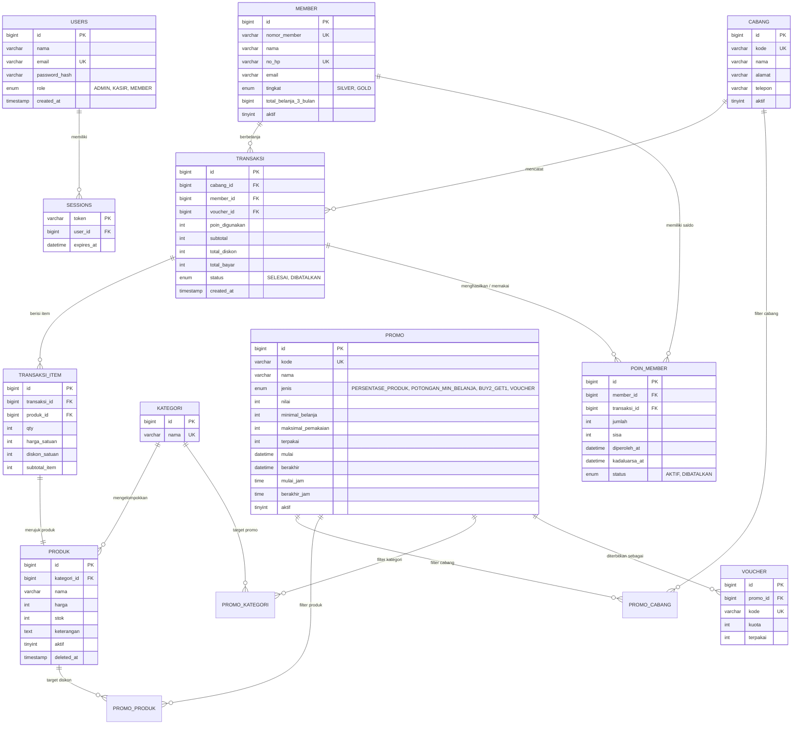

# SeduhPoin — Sistem Poin Member dan Promo Kedai Kopi Seduh

Sistem informasi manajemen berbasis web untuk **Kedai Kopi Seduh** (3 Cabang: Pusat, Timur, dan Barat) yang mengintegrasikan pengelolaan master data, konfigurasi promosi multi-kondisi, transaksi kasir POS, loyalitas member berjenjang (Silver & Gold), serta laporan analitik biaya promosi dan poin aktif.

Aplikasi dibangun menggunakan bahasa **Go (Golang)** murni dengan arsitektur modular **Clean/Layered Architecture** (`net/http`, `html/template`), database **MySQL (XAMPP)**, serta antarmuka HTML5 & CSS modern bertema kedai kopi.

---

## ☕ Spesifikasi & Aturan Bisnis (Topik 5)

Kedai Kopi Seduh memiliki tiga cabang operasional. Sistem menghubungkan program keanggotaan dan promosi dengan transaksi penjualan di seluruh cabang:

1. **Perolehan Poin Member**:
   - Pelanggan yang terdaftar sebagai member mendapatkan **1 poin untuk setiap kelipatan Rp10.000** dari total belanja setelah potongan promo (pembulatan ke bawah).
   - Member dengan tingkat **Gold** mendapatkan poin **1,5 kali lipat** dari perolehan standar.
   - Poin memiliki masa berlaku **6 bulan** sejak tanggal diperoleh.
2. **Penukaran Poin (Redemption)**:
   - Nilai tukar: **1 poin = Rp1.000**.
   - Maksimal penukaran poin: **Paling banyak 50% dari total belanja** (setelah diskon promo).
   - Urutan konsumsi poin: **FEFO / FIFO** (poin yang paling dekat masa berlakunya/kedaluwarsa dikonsumsi terlebih dahulu).
3. **Tingkat Member (Membership Tiers)**:
   - Terdiri dari dua tingkat: **Silver** dan **Gold**.
   - Member baru memulai dari tingkat **Silver**.
   - Member dengan akumulasi belanja minimal **Rp1.500.000 dalam 3 bulan terakhir** berhak menjadi **Gold** dan menikmati multiplier poin 1,5x.
4. **Jenis & Ketentuan Promo**:
   - **Diskon Persentase Produk (`PERSENTASE_PRODUK`)**: Potongan harga persentase untuk item produk tertentu.
   - **Potongan Minimal Belanja (`POTONGAN_MIN_BELANJA`)**: Potongan nominal rupiah jika transaksi mencapai batas belanja tertentu.
   - **Beli 2 Gratis 1 (`BUY2_GET1`)**: Promo beli 2 gratis 1 untuk kategori produk tertentu.
   - **Voucher Berkode (`VOUCHER`)**: Kupon berkode unik dengan kuota pemakaian terbatas.
   - *Batasan Fleksibel*: Promo dapat dibatasi berdasarkan rentang tanggal aktif, cabang tertentu (`promo_cabang`), dan jam operasional (*happy hour*: `mulai_jam` - `berakhir_jam`).
   - *Aturan Penggabungan Promo*: Promo produk dapat digabung dengan promo lain, tetapi **potongan minimal belanja TIDAK DAPAT digabung dengan voucher**.
5. **Pembatalan Transaksi**:
   - Jika transaksi dibatalkan:
     - Poin yang diperoleh dari transaksi tersebut ditarik kembali (*void*).
     - Poin yang ditukarkan pada transaksi tersebut dikembalikan secara utuh kepada member.
     - Stok produk dipulihkan dan kuota voucher dikembalikan.
6. **Kebutuhan Laporan**:
   - Laporan biaya setiap promo (total nominal rupiah diskon yang dikeluarkan per promo).
   - Jumlah poin yang masih berlaku beserta nilainya dalam rupiah (`sisa_poin * 1.000`).
   - Perkembangan dan distribusi jumlah member per tingkat (Silver vs Gold).

---

## 👥 Pembagian Lingkup Kerja Tim

| Lingkup | Modul & Tanggung Jawab | Penanggung Jawab | Status |
| :--- | :--- | :--- | :--- |
| **Lingkup 1** | **Master Data**: Pengelolaan katalog produk, kategori, 3 cabang, dan data member | **Nabila** | Sedang Disempurnakan *(On Progress)* |
| **Lingkup 2** | **Pengaturan Promo & Voucher**: Promo multi-kondisi, batasan jam/cabang, dan kuota voucher | **Nabila** | Sedang Disempurnakan *(On Progress)* |
| **Auth & RBAC** | **Autentikasi & Otorisasi Peran**: Bcrypt, Session token 7 hari, middleware `RequireLogin` & `RequireRole` | **Nabila** | Sedang Disempurnakan *(On Progress)* |
| **Lingkup 3** | **Transaksi Penjualan**: Perhitungan promo kombinasi, penukaran poin FEFO, dan akumulasi poin | **Rahma** | Siap Dikerjakan |
| **Lingkup 4** | **Pembatalan Transaksi**: Rollback status, penarikan poin reward, refund poin terpakai, restock | **Hilal** | Siap Dikerjakan (Setelah L3) |
| **Lingkup 5** | **Lifecycle Poin & Tier Member**: Validasi expired 6 bulan & evaluasi belanja 3 bulan (Silver/Gold) | **Dinda** | Siap Dikerjakan |
| **Lingkup 6** | **Laporan Analitik**: Biaya realisasi promo, saldo poin aktif (Rp), dan statistik member | **Luhur** | Siap Dikerjakan |

---

## 🛡️ Matriks Akses & Otorisasi Sistem (RBAC)

Sistem menerapkan **Role-Based Access Control (RBAC)** di sisi server menggunakan middleware `RequireRole` agar rute aman dari akses tidak sah:

| Aksi / Modul | Admin / Pemilik | Kasir | Member | Keterangan Rute / Hak Akses |
| :--- | :---: | :---: | :---: | :--- |
| **Login, Register & Logout** | ✔️ | ✔️ | ✔️ | Terbuka / Public & Session |
| **Lihat Dashboard Beranda** | ✔️ | ✔️ | ✔️* | `GET /` — Konten & widget otomatis beda per peran |
| **Lihat Produk & Menu** | ✔️ | ✔️ | ❌ | Admin di `/produk`, Kasir pada POS transaksi |
| **Kelola Produk & Cabang (CRUD)** | ✔️ | ❌ | ❌ | `GET/POST /produk`, `/cabang` (Khusus Admin) |
| **Kelola Data Member** | ✔️ | ❌ | ❌ | `GET/POST /member` (Khusus Admin) |
| **Kelola Promo & Voucher (CRUD)** | ✔️ | ❌ | ❌ | `GET/POST /promo`, `/voucher` (Khusus Admin) |
| **Memproses Transaksi POS** | ✔️ | ✔️ | ❌ | `POST /transaksi` (Admin & Kasir) |
| **Terapkan Promo & Poin** | ✔️ | ✔️ | ❌ | Dihitung otomatis di kasir saat input pesanan |
| **Melihat Riwayat Transaksi** | ✔️ | ✔️ | ✔️* | Kasir/Admin semua trx, Member data sendiri |
| **Membatalkan Transaksi** | ✔️ | ✔️ | ❌ | `POST /transaksi/{id}/batal` (Admin & Kasir) |
| **Kelola Masa Berlaku Poin & Tier** | ✔️ | ❌ | ❌ | Audit kedaluwarsa poin & evaluasi Gold/Silver |
| **Melihat Saldo & Tingkat Member** | ✔️ | ✔️ | ✔️* | Member melihat profil loyalitas miliknya sendiri |
| **Melihat Laporan Analitik Bisnis** | ✔️ | ❌ | ❌ | `GET /laporan` (Khusus Admin/Pemilik) |

*\*Catatan: Member hanya dapat melihat riwayat dan saldo poin miliknya sendiri.*

---

## 🏛️ Arsitektur Sistem

Sistem menggunakan **Layered Architecture** untuk menjamin keteraturan kode dan memudahkan pengerjaan paralel antar anggota tim tanpa konflik:

```text
poinseduh/
├── cmd/
│   └── web/
│       └── main.go                 # HTTP ServeMux, Server lifecycle, dependency injection
├── db/
│   ├── schema.sql                  # DDL skema lengkap MySQL & seed data awal
│   └── auth.sql                    # Skema tabel users, sessions, dan akun demo
├── internal/
│   ├── config/
│   │   └── config.go               # Pembaca konfigurasi environment (.env)
│   ├── handler/
│   │   ├── auth.go                 # Login, register, logout
│   │   ├── admin.go                # Handler cabang, member, promo, voucher (Lingkup 1 & 2)
│   │   ├── catalog.go              # Handler CRUD produk & kategori (Lingkup 1)
│   │   ├── halaman.go              # Handler dashboard ringkasan
│   │   ├── render.go               # Engine HTML Template renderer
│   │   └── errors.go               # HTTP error helper
│   ├── middleware/
│   │   ├── auth.go                 # Middleware RequireLogin & konteks User
│   │   └── logging.go              # Request HTTP logger
│   ├── model/
│   │   ├── admin.go                # Entity: Cabang, Produk, Member, Promo, Voucher
│   │   ├── user.go                 # Entity User & domain error auth
│   │   └── errors.go               # Sentinel errors
│   ├── repository/
│   │   ├── admin.go                # Query SQL Cabang, Member, Promo, Voucher
│   │   ├── catalog.go              # Query SQL Produk & Kategori
│   │   ├── user.go                 # Query SQL Users
│   │   └── session.go              # Query SQL Sessions
│   └── service/
│       └── auth.go                 # Logika bisnis autentikasi bcrypt & session
├── templates/                      # UI Views (HTML5 + CSS Bertema Kopi)
│   ├── auth/
│   │   ├── login.html              # Halaman login modern
│   │   └── register.html           # Halaman registrasi akun
│   ├── layout.html                 # Master layout & responsive stylesheet
│   ├── header.html                 # Topbar header
│   ├── sidebar.html                # Sidebar navigasi profesional
│   ├── footer.html                 # Footer aplikasi
│   ├── home.html                   # Dashboard ringkasan eksekutif
│   ├── produk.html                 # Lingkup 1: UI CRUD Produk & Kategori
│   ├── cabang.html                 # Lingkup 1: UI Cabang Kedai
│   ├── member.html                 # Lingkup 1: UI Registrasi & List Member
│   ├── promo.html                  # Lingkup 2: UI Pengaturan Promo
│   └── voucher.html                # Lingkup 2: UI Voucher Berkode
├── .env                            # Konfigurasi aktif lokal
├── .env.example                    # Template konfigurasi
├── .gitignore                      # File pengecualian Git
├── go.mod                          # Definisi Go module
└── README.md                       # Dokumentasi sistem & panduan teknis tim
```

---

## 🗄️ Skema Database (MySQL / XAMPP)

Tabel-tabel database `seduhpoin` telah dirancang dan dinormalisasi untuk memenuhi seluruh kebutuhan sistem:



---

## 📌 Status Implementasi & Rencana Peningkatan (Nabila)

Fitur fondasi arsitektur, autentikasi session, serta Lingkup 1 dan 2 telah berfungsi dan saat ini berstatus **dalam progres penyempurnaan aktif** (*on progress*).

### • Penyempurnaan dan peningkatan fitur yang telah dikembangkan (Nabila), meliputi:
- **Evaluasi struktur kode, alur sistem, dan kesiapan integrasi antarmodul:**
  Memastikan arsitektur *Layered/Modular* di Go (`handler`, `service`, `repository`, `model`, `middleware`) tetap bersih, terisolasi, dan siap diintegrasikan dengan modul transaksi, pembatalan, poin, serta laporan.
- **Penyempurnaan validasi input serta pengujian fitur autentikasi dan session:**
  Pengujian keamanan hash password `bcrypt`, proteksi cookie `HttpOnly` dengan expiry 7 hari, pencegahan email duplikat, dan penegakan otorisasi peran via middleware `RequireRole` (menolak akses ilegal dengan respon HTTP 403).
- **Penyempurnaan tampilan dan konsistensi antarmuka berdasarkan peran pengguna:**
  Menjaga standar UI/UX profesional bertema kedai kopi, perbaikan tata letak sidebar dan header dinamis agar bebas dari tumpang tindih teks, serta diferensiasi tampilan beranda khusus Admin, Kasir, dan Member.
- **Pengujian fungsi pengelolaan produk, cabang, member, promo, dan voucher:**
  Verifikasi alur data CRUD produk dan soft-delete (`deleted_at`), validasi identitas 3 cabang, registrasi member (Silver & Gold), mekanisme 4 jenis promo (persentase, minimal belanja, B2G1, voucher), serta batasan cabang dan jam operasional (*happy hour*).
- **Evaluasi relasi serta integritas database agar sesuai dengan kebutuhan seluruh lingkup:**
  Menyinkronkan skema database (`db/schema.sql`) dengan menambahkan tabel `transaksi_item`, relasi foreign key berintegritas, serta kolom `voucher_id` dan `poin_digunakan` agar seluruh kebutuhan pengerjaan anggota tim terpenuhi.

---

### Rincian Modul yang Telah Dibangun & Sedang Disempurnakan (Nabila)

#### 1. Lingkup 1 — Pengelolaan Data Produk, Cabang, dan Member
- **Menu & Stok Produk (`/produk`)**: CRUD produk lengkap terhubung relasi kategori, penetapan harga jual, manajemen kuantitas stok, dan mekanisme soft-delete (`deleted_at`).
- **Cabang Kedai (`/cabang`)**: Manajemen data 3 cabang resmi (**Seduh Pusat**, **Seduh Timur**, dan **Seduh Barat**) lengkap dengan kode identifikasi, nomor kontak, dan alamat operasional.
- **Data Member (`/member`)**: Pendaftaran kartu anggota loyalitas, format kontak unik, penanda tingkatan **Silver** (standar) dan **Gold** (belanja $\ge$ Rp1.500.000 dalam 3 bulan terakhir).

#### 2. Lingkup 2 — Pengaturan Promo dan Voucher
- **Pengaturan Promo Multi-Kondisi (`/promo`)**:
  - 4 jenis promo: Diskon Persentase Produk, Potongan Min. Belanja, Buy 2 Get 1 Kategori, dan Promo Berbasis Voucher.
  - Batasan fleksibel: Rentang tanggal berlaku, jam operasional tertentu (*happy hour*), dan seleksi target cabang maupun item produk/kategori.
- **Kupon Voucher Berkode (`/voucher`)**:
  - Penerbitan kode voucher eksklusif dengan pembatasan kuota klaim maksimal.

#### 3. Autentikasi & Otorisasi Peran Server-Side (Auth & RBAC)
- Login berbasis cookie session `HttpOnly` dengan keamanan `SameSite=Lax`.
- Hashing password menggunakan algoritma `bcrypt`.
- Otorisasi server-side: middleware `RequireLogin` dan `RequireRole("ADMIN")` / `RequireRole("ADMIN", "KASIR")`.
- Mendukung 3 peran pengguna:
  - **👑 Admin / Pemilik**: Hak akses penuh kelola master data, promo, voucher, member, dan memantau analitik.
  - **☕ Kasir**: Menangani kasir POS transaksi, klaim promo, penukaran poin, dan pembatalan transaksi.
  - **👤 Member**: Memiliki nomor anggota, cek reward poin, tiering, dan riwayat belanja.

**Kredensial Akun untuk Simulasi:**
- **Admin/Pemilik**: `admin@seduhkopi.com` | Password: `admin123`
- **Kasir**: `kasir@seduhkopi.com` | Password: `kasir123`
- **Member**: `member@seduhkopi.com` | Password: `member123`

---

## 🚀 Panduan Teknis & Langkah Pengerjaan Tim (Semua Anggota)

Agar pengembangan sistem berjalan lancar dan terstruktur, berikut urutan ketergantungan dan langkah kerja spesifik untuk masing-masing anggota:

### ⏱️ Urutan & Ketergantungan Pengerjaan Antar Anggota

```
[Nabila: Fondasi DB, Auth & L1-L2 (On Progress)]
        │
        ├───► [Rahma: Lingkup 3 - Transaksi POS] ────► [Hilal: Lingkup 4 - Pembatalan Transaksi]
        │                                                     ▲ (Tunggu L3 selesai)
        ├───► [Dinda: Lingkup 5 - Poin & Tier Member]
        │
        └───► [Luhur: Lingkup 6 - Laporan Analitik Bisnis]
```

- **Rahma, Dinda, dan Luhur** dapat **langsung mulai bekerja sekarang secara paralel** karena seluruh skema tabel, seed data awal, dan session login sudah siap di branch `dev`.
- **Hilal** menunggu modul transaksi dari **Rahma** selesai dicatat di DB, agar proses pembatalan, pembalikan poin, restock barang, dan kuota voucher dapat diuji secara riil.

---

### 🔹 1. Lingkup 1, Lingkup 2 & Fondasi Sistem (Nabila — On Progress)
- **Fokus Utama**: Menjaga stabilitas arsitektur, menyempurnakan fitur yang telah dibuat, serta memastikan antarmuka dan basis data terintegrasi sempurna.
- **Daftar Rencana Peningkatan**:
  1. [ ] **Evaluasi struktur kode & modularitas**: Pastikan pemisahan handler, service, model, dan repository tetap rapi agar tidak terjadi bentrok saat modul Rahma/Hilal/Dinda/Luhur digabungkan.
  2. [ ] **Penyempurnaan autentikasi & validasi**: Uji validasi input pendaftaran, login, logout, dan pengujian boundary rute dengan middleware `RequireRole` (403 Forbidden).
  3. [ ] **Konsistensi UI/UX**: Pastikan komponen template (`layout.html`, `sidebar.html`, `header.html`) tampil rapi, responsif, dan bebas error rendering.
  4. [ ] **Pengujian CRUD**: Uji operasi tambah, edit, soft-delete produk, kelola cabang, pendaftaran member, aturan multi-promo, dan kuota voucher.
  5. [ ] **Integritas Database**: Mengawal skema tabel (`db/schema.sql`) agar selalu sinkron dengan kebutuhan kode seluruh tim.

---

### 🔹 2. Lingkup 3: Transaksi Penjualan & Kasir POS (Rahma)
- **Tujuan**: Membangun modul kasir penjualan (POS) di cabang terpilih yang menghitung kalkulasi promo, penukaran poin, dan perolehan poin baru.
- **Status**: **Siap Dikerjakan Sekarang**.
- **Berkas yang Perlu Dikerjakan**:
  - `internal/handler/transaksi.go` (routing `GET /transaksi` untuk form POS & `POST /transaksi` untuk proses simpan)
  - `internal/repository/transaksi.go` (logika query kalkulasi promo, simpan transaksi & item, potong stok, potong poin, tambah poin baru)
  - `templates/transaksi.html` (antarmuka kasir penjualan POS interaktif)
  - Daftarkan route di `cmd/web/main.go` menggunakan middleware `adminKasir` dan tambahkan menu navigasi di `templates/sidebar.html`.
- **Tabel Database yang Dipakai**: `transaksi`, `transaksi_item`, `produk`, `promo`, `promo_produk`, `promo_kategori`, `promo_cabang`, `voucher`, `poin_member`, `member`.
- **Langkah-Langkah Logika Bisnis Wajib**:
  1. **Form Kasir POS**: Kasir memilih cabang aktif, memilih produk serta kuantitas, mencari member berdasarkan nomor/nama (opsional), memasukkan kode voucher (opsional), dan opsi centang penukaran poin.
  2. **Hitung Subtotal Belanja**: Total dari $\sum (\text{harga\_satuan} \times \text{qty})$.
  3. **Evaluasi Diskon Promosi Bertumpuk**:
     - *Diskon Persentase Produk (`PERSENTASE_PRODUK`)*: Periksa apakah produk ada di tabel `promo_produk`. Potong harga per unit sebesar $X\%$. Simpan nilai diskon ke `diskon_satuan` pada `transaksi_item`.
     - *Beli 2 Gratis 1 (`BUY2_GET1`)*: Periksa target kategori di `promo_kategori`. Untuk setiap kelipatan 3 item sejenis, berikan 1 item gratis (`diskon_satuan = harga_satuan`).
     - *Potongan Min. Belanja (`POTONGAN_MIN_BELANJA`)*: Jika subtotal $\ge$ `minimal_belanja` **DAN tidak ada kode voucher yang digunakan**.
     - *Voucher Berkode (`VOUCHER`)*: Validasi masa aktif, jam operasional (*happy hour*), cabang, dan sisa kuota. Jika voucher digunakan, **promo potongan min. belanja tidak boleh aktif** (aturan bentrok Topik 5).
  4. **Penukaran Poin Member (Redemption)**:
     - Hanya berlaku jika transaksi terhubung dengan member terdaftar dan memiliki saldo poin aktif (`sisa > 0 AND status = 'AKTIF' AND kadaluarsa_at > NOW()`).
     - Nilai tukar: **1 poin = Rp1.000**.
     - **Batas maksimal penukaran:** Paling banyak **50% dari total belanja** setelah potongan promo.
     - **Metode FEFO (First Expired First Out):** Ambil poin terdekat yang akan kedaluwarsa (`ORDER BY kadaluarsa_at ASC`). Potong kolom `sisa` pada tabel `poin_member`. Simpan jumlah poin yang ditukar pada kolom `poin_digunakan` di tabel `transaksi`.
  5. **Perolehan Poin Baru**:
     - Dihitung dari `total_bayar` akhir: `floor(total_bayar / 10000) * 1 poin`.
     - **Multiplier Tier Gold:** Jika status member adalah `GOLD`, kalikan perolehan poin dengan **1,5x** (contoh: belanja Rp100.000 $\rightarrow$ Silver dapat 10 poin, Gold dapat 15 poin).
     - Terbitkan baris poin baru ke `poin_member` dengan masa kedaluwarsa **6 bulan**:
       `INSERT INTO poin_member (member_id, transaksi_id, jumlah, sisa, diperoleh_at, kadaluarsa_at, status) VALUES (?, ?, ?, ?, NOW(), NOW() + INTERVAL 6 MONTH, 'AKTIF')`.
  6. **Catat Detail & Kurangi Stok**:
     - Simpan setiap item yang dibeli ke tabel `transaksi_item` (snapshot harga, qty, diskon).
     - Kurangi kuantitas stok produk di tabel `produk` (`stok = stok - qty`).

---

### 🔹 3. Lingkup 4: Pembatalan Transaksi (Hilal)
- **Tujuan**: Membatalkan transaksi penjualan jika terjadi kesalahan atau pembatalan pesanan oleh pelanggan, dengan rollback data yang konsisten.
- **Status**: **Menunggu Modul Transaksi Rahma Selesai**.
- **Berkas yang Perlu Dikerjakan**:
  - `internal/handler/batal.go` (routing `POST /transaksi/{id}/batal`)
  - `internal/repository/batal.go` (logika rollback database transaksi)
  - Tampilkan tombol konfirmasi "Batalkan Transaksi" pada baris tabel riwayat transaksi kasir.
- **Tabel Database yang Dipakai**: `transaksi`, `transaksi_item`, `produk`, `poin_member`, `voucher`.
- **Langkah-Langkah Logika Bisnis (Wajib Atomic Transaction / `db.BeginTx`)**:
  1. Validasi transaksi yang akan dibatalkan (pastikan status saat ini adalah `SELESAI`).
  2. Ubah status transaksi menjadi `DIBATALKAN`:
     `UPDATE transaksi SET status = 'DIBATALKAN' WHERE id = ?`.
  3. **Tarik Kembali Poin yang Diperoleh**:
     - Poin reward yang diterbitkan dari transaksi ini ditarik kembali (*void*) agar tidak bisa digunakan:
       `UPDATE poin_member SET status = 'DIBATALKAN', sisa = 0 WHERE transaksi_id = ? AND status = 'AKTIF'`.
  4. **Kembalikan Poin yang Ditukarkan**:
     - Ambil nilai `poin_digunakan` dari tabel `transaksi`. Jika lebih dari 0, kembalikan poin tersebut ke saldo aktif member (dapat di-insert sebagai baris baru pemulihan atau mengembalikan sisa batch poin sebelumnya).
  5. **Restock Kuantitas Produk**:
     - Baca daftar item yang dibatalkan dari tabel `transaksi_item`.
     - Kembalikan stok setiap produk: `UPDATE produk SET stok = stok + ? WHERE id = ?`.
  6. **Kembalikan Kuota Voucher**:
     - Jika transaksi menggunakan voucher (`voucher_id IS NOT NULL`), kurangi angka pemakaian voucher:
       `UPDATE voucher SET terpakai = terpakai - 1 WHERE id = ?`.

---

### 🔹 4. Lingkup 5: Pengelolaan Masa Berlaku Poin & Tingkat Member (Dinda)
- **Tujuan**: Menangani pemantauan masa berlaku poin (6 bulan), audit poin kedaluwarsa, dan evaluasi otomatis tingkat keanggotaan (Silver vs Gold).
- **Status**: **Siap Dikerjakan Sekarang**.
- **Berkas yang Perlu Dikerjakan**:
  - `internal/handler/member_tier.go` (routing `GET /member/tier` atau manajemen poin)
  - `internal/repository/member_tier.go` (query evaluasi akumulasi belanja 3 bulan dan status kedaluwarsa poin)
  - `templates/poin_tier.html` (halaman monitoring batch poin loyalitas dan status tingkat member)
  - Daftarkan route di `cmd/web/main.go` dan tambahkan menu di `templates/sidebar.html`.
- **Langkah-Langkah Logika Bisnis**:
  1. **Pemantauan Masa Berlaku Poin (6 Bulan)**:
     - Tampilkan riwayat batch poin per member: tanggal perolehan, tanggal kedaluwarsa, jumlah awal, sisa poin aktif, dan status (*Aktif* / *Kedaluwarsa* / *Dibatalkan*).
     - Query poin aktif valid (belum kedaluwarsa):
       ```sql
       SELECT member_id, SUM(sisa) AS poin_aktif, (SUM(sisa) * 1000) AS nilai_rupiah
       FROM poin_member
       WHERE status = 'AKTIF' AND kadaluarsa_at > NOW()
       GROUP BY member_id;
       ```
     - Tandai secara visual atau ubah status poin yang tanggal kedaluwarsanya telah lewat (`kadaluarsa_at <= NOW()`).
  2. **Evaluasi Otomatis Tingkat Member (Silver & Gold)**:
     - Hitung akumulasi belanja riil member dalam **3 bulan terakhir**:
       ```sql
       SELECT COALESCE(SUM(total_bayar), 0)
       FROM transaksi
       WHERE member_id = ? AND status = 'SELESAI'
         AND created_at >= NOW() - INTERVAL 3 MONTH;
       ```
     - **Aturan Evaluasi:**
       - Jika akumulasi belanja 3 bulan $\ge$ **Rp1.500.000** $\rightarrow$ Status member diubah/dipertahankan menjadi **GOLD** (berhak multiplier poin 1,5x).
       - Jika akumulasi belanja 3 bulan $<$ **Rp1.500.000** $\rightarrow$ Status member adalah **SILVER** (perolehan poin standar 1x).
     - Simpan hasil perhitungan ke tabel member:
       `UPDATE member SET tingkat = ?, total_belanja_3_bulan = ? WHERE id = ?`.

---

### 🔹 5. Lingkup 6: Laporan Promo, Poin, dan Member (Luhur)
- **Tujuan**: Membangun modul pelaporan analitik bisnis untuk pemilik kedai guna memantau efektivitas promo, nilai liabilitas poin, dan demografi member.
- **Status**: **Siap Dikerjakan Sekarang** *(Kerangka awal query dan UI sudah tersedia di `/laporan`)*.
- **Berkas yang Perlu Dikerjakan**:
  - `internal/handler/laporan.go` (routing `GET /laporan`)
  - `internal/repository/laporan.go` (query agregasi SQL laporan komprehensif)
  - `templates/laporan.html` (penyempurnaan tabel analitik dan visualisasi data)
  - Pastikan route hanya dapat diakses oleh Admin (`adminOnly`) di `cmd/web/main.go`.
- **3 Laporan Wajib Sesuai Soal Topik 5**:
  1. **Laporan Biaya Setiap Promo**:
     - Menghitung total realisasi rupiah potongan diskon yang dikeluarkan kedai untuk masing-masing promo.
     - Rekapitulasi per promo: kode promo, nama promo, jenis promo, jumlah kali pemakaian, dan total biaya subsidi promo (Rp).
  2. **Laporan Jumlah Poin Masih Berlaku & Nilai Rupiahnya**:
     - Menghitung total saldo poin aktif yang belum kedaluwarsa di seluruh cabang:
       ```sql
       SELECT 
           COUNT(DISTINCT member_id) AS total_member_berpoin,
           COALESCE(SUM(sisa), 0) AS total_poin_aktif,
           COALESCE(SUM(sisa) * 1000, 0) AS total_nilai_rupiah
       FROM poin_member
       WHERE status = 'AKTIF' AND kadaluarsa_at > NOW();
       ```
  3. **Laporan Perkembangan Jumlah Member per Tingkat**:
     - Rekapitulasi perbandingan total member **Silver** vs **Gold**.
     - Menampilkan tabel persebaran member per cabang dan tren pertumbuhan registrasi member baru per bulan.

---

## 🛠️ Panduan Menjalankan Aplikasi di Lokal (XAMPP)

1. **Jalankan Apache & MySQL di XAMPP Control Panel**.
2. **Import Database (Cukup 1 Berkas)**:
   - Buka phpMyAdmin di `http://localhost/phpmyadmin`.
   - Import berkas [`db/schema.sql`](db/schema.sql). Database `seduhpoin`, seluruh tabel, dan data simulasi awal akan otomatis terbuat.
3. **Konfigurasi `.env`**:
   Pastikan berkas `.env` ada di root direktori dengan isi:
   ```env
   DB_DSN=root:@tcp(127.0.0.1:3306)/seduhpoin?parseTime=true&charset=utf8mb4
   ADDR=:8080
   COOKIE_SECURE=false
   ```
4. **Jalankan Web Server**:
   ```bash
   go run ./cmd/web
   ```
5. **Akses Aplikasi**:
   Buka peramban di `http://localhost:8080`.
   Gunakan akun demo:
   - Email: `admin@seduhkopi.com`
   - Password: `admin123`

---

## 🌿 Panduan Kolaborasi Git Tim

> **Alur wajib**: semua anggota push ke branch `dev` terlebih dahulu. Branch `main` hanya diupdate oleh Nabila (ketua) setelah semua lingkup di `dev` sudah berjalan & direview.

```
origin/main   ← versi stabil final (hanya Nabila yang merge ke sini)
      ↑
origin/dev    ← branch integrasi tim (semua push & pull request ke sini)
      ↑
feat/lingkup-3-transaksi  ← branch kerja masing-masing anggota
feat/lingkup-4-batal
feat/lingkup-5-poin-tier
feat/lingkup-6-laporan
```

1. **Clone Repo & Pindah ke `dev`**:
   ```bash
   git clone https://github.com/bilaaah/SeduhPoin.git
   cd SeduhPoin
   git checkout dev
   ```
2. **Buat Branch Kerja Khusus dari `dev`**:
   ```bash
   git checkout -b fitur/lingkup-3-transaksi    # Rahma
   git checkout -b fitur/lingkup-4-batal        # Hilal
   git checkout -b fitur/lingkup-5-poin-tier    # Dinda
   git checkout -b fitur/lingkup-6-laporan      # Luhur
   ```
3. **Commit dengan Pesan Deskriptif**:
   ```bash
   git add .
   git commit -m "feat(lingkup-3): kalkulasi diskon promo dan penukaran poin FEFO"
   ```
4. **Sinkronisasi dengan `dev` Sebelum Push** (hindari konflik):
   ```bash
   git pull origin dev --rebase
   git push origin fitur/lingkup-3-transaksi
   ```
5. **Buat Pull Request ke `dev`** (bukan ke `main`) melalui GitHub, lalu minta Nabila untuk mereview.
