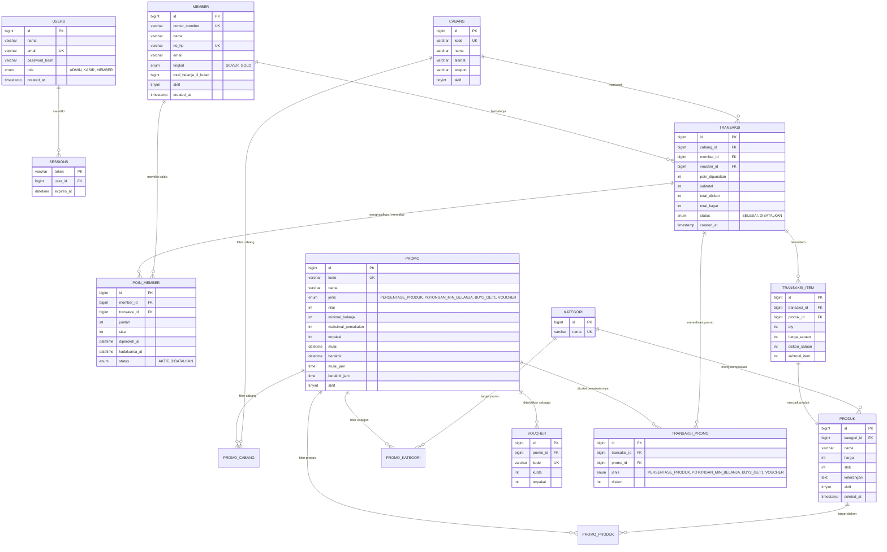

# SeduhPoin — Sistem Poin Member dan Promo Kedai Kopi Seduh

Sistem informasi manajemen berbasis web untuk **Kedai Kopi Seduh** (3 Cabang: Pusat, Timur, dan Barat) yang mengintegrasikan pengelolaan master data, konfigurasi promosi multi-kondisi, transaksi kasir POS, loyalitas member berjenjang (Silver & Gold), serta laporan analitik biaya promosi dan poin aktif.

Aplikasi dibangun menggunakan bahasa **Go (Golang)** murni dengan arsitektur modular **Clean/Layered Architecture** (`net/http`, `html/template`), database **MySQL (XAMPP)**, serta antarmuka HTML5 & CSS modern bertema kedai kopi.

---

## ☕ Spesifikasi & Aturan Bisnis (Topik 5)

Kedai Kopi Seduh memiliki tiga cabang operasional. Sistem menghubungkan program keanggotaan dan promosi dengan transaksi penjualan di seluruh cabang:

1. **Perolehan Poin Member**:
   - Pelanggan yang terdaftar sebagai member mendapatkan **1 poin untuk setiap kelipatan Rp10.000** dari total belanja setelah potongan promo (pembulatan ke bawah).
   - Member dengan tingkat **Gold** mendapatkan poin **1,5 kali lipat** dari perolehan standar.
   - Poin memiliki masa berlaku **6 bulan** sejak tanggal diperoleh.
2. **Penukaran Poin (Redemption)**:
   - Nilai tukar: **1 poin = Rp1.000**.
   - Maksimal penukaran poin: **Paling banyak 50% dari total belanja** (setelah diskon promo).
   - Urutan konsumsi poin: **FEFO / FIFO** (poin yang paling dekat masa berlakunya/kedaluwarsa dikonsumsi terlebih dahulu).
3. **Tingkat Member (Membership Tiers)**:
   - Terdiri dari dua tingkat: **Silver** dan **Gold**.
   - Member baru memulai dari tingkat **Silver**.
   - Member dengan akumulasi belanja minimal **Rp1.500.000 dalam 3 bulan terakhir** berhak menjadi **Gold** dan menikmati multiplier poin 1,5x.
4. **Jenis & Ketentuan Promo**:
   - **Diskon Persentase Produk (`PERSENTASE_PRODUK`)**: Potongan harga persentase untuk item produk tertentu.
   - **Potongan Minimal Belanja (`POTONGAN_MIN_BELANJA`)**: Potongan nominal rupiah jika transaksi mencapai batas belanja tertentu.
   - **Beli 2 Gratis 1 (`BUY2_GET1`)**: Promo beli 2 gratis 1 untuk kategori produk tertentu.
   - **Voucher Berkode (`VOUCHER`)**: Kupon berkode unik dengan kuota pemakaian terbatas.
   - *Batasan Fleksibel*: Promo dapat dibatasi berdasarkan rentang tanggal aktif, cabang tertentu (`promo_cabang`), dan jam operasional (*happy hour*: `mulai_jam` - `berakhir_jam`).
   - *Aturan Penggabungan Promo*: Promo produk dapat digabung dengan promo lain, tetapi **potongan minimal belanja TIDAK DAPAT digabung dengan voucher**.
5. **Pembatalan Transaksi**:
   - Jika transaksi dibatalkan:
     - Poin yang diperoleh dari transaksi tersebut ditarik kembali (*void*).
     - Poin yang ditukarkan pada transaksi tersebut dikembalikan secara utuh kepada member.
     - Stok produk dipulihkan dan kuota voucher dikembalikan.
6. **Kebutuhan Laporan**:
   - Laporan biaya setiap promo (total nominal rupiah diskon yang dikeluarkan per promo).
   - Jumlah poin yang masih berlaku beserta nilainya dalam rupiah (`sisa_poin * 1.000`).
   - Perkembangan dan distribusi jumlah member per tingkat (Silver vs Gold).

---

## 👥 Pembagian Lingkup Kerja Tim

| Lingkup | Modul & Tanggung Jawab | Penanggung Jawab | Status |
| :--- | :--- | :--- | :--- |
| **Lingkup 1** | **Master Data**: Pengelolaan katalog produk, kategori, 3 cabang, dan data member | **Nabila** | **Selesai** |
| **Lingkup 2** | **Pengaturan Promo & Voucher**: Promo multi-kondisi, batasan jam/cabang, dan kuota voucher | **Nabila** | **Selesai** |
| **Auth & RBAC** | **Autentikasi & Otorisasi Peran**: Bcrypt, Session token 7 hari, middleware `RequireLogin` & `RequireRole` | **Nabila** | **Selesai** |
| **Lingkup 3** | **Transaksi Penjualan**: Perhitungan promo kombinasi, penukaran poin FEFO, dan akumulasi poin | **Rahma** | **Selesai** |
| **Lingkup 4** | **Pembatalan Transaksi**: Rollback status, penarikan poin reward, refund poin terpakai, restock | **Hilal** | Siap Dikerjakan (Setelah L3) |
| **Lingkup 5** | **Lifecycle Poin & Tier Member**: Validasi expired 6 bulan & evaluasi belanja 3 bulan (Silver/Gold) | **Dinda** | **Selesai** |
| **Lingkup 6** | **Laporan Analitik**: Biaya realisasi promo, saldo poin aktif (Rp), dan statistik member | **Luhur** | **Selesai** |

---

## 🛡️ Matriks Akses & Otorisasi Sistem (RBAC)

Sistem menerapkan **Role-Based Access Control (RBAC)** di sisi server menggunakan middleware `RequireRole` agar rute aman dari akses tidak sah:

| Aksi / Modul | Admin / Pemilik | Kasir | Member | Keterangan Rute / Hak Akses |
| :--- | :---: | :---: | :---: | :--- |
| **Login, Register & Logout** | ✔️ | ✔️ | ✔️ | Terbuka / Public & Session |
| **Lihat Dashboard Beranda** | ✔️ | ✔️ | ✔️* | `GET /` — Konten & widget otomatis beda per peran |
| **Lihat Produk & Menu** | ✔️ | ✔️ | ❌ | Admin di `/produk`, Kasir pada POS transaksi |
| **Kelola Produk & Cabang (CRUD)** | ✔️ | ❌ | ❌ | `GET/POST /produk`, `/cabang` (Khusus Admin) |
| **Kelola Data Member** | ✔️ | ❌ | ❌ | `GET/POST /member` (Khusus Admin) |
| **Kelola Promo & Voucher (CRUD)** | ✔️ | ❌ | ❌ | `GET/POST /promo`, `/voucher` (Khusus Admin) |
| **Memproses Transaksi POS** | ✔️ | ✔️ | ❌ | `POST /transaksi` (Admin & Kasir) |
| **Terapkan Promo & Poin** | ✔️ | ✔️ | ❌ | Dihitung otomatis di kasir saat input pesanan |
| **Melihat Riwayat Transaksi** | ✔️ | ✔️ | ✔️* | Kasir/Admin semua trx, Member data sendiri |
| **Membatalkan Transaksi** | ✔️ | ✔️ | ❌ | `POST /transaksi/{id}/batal` (Admin & Kasir) |
| **Kelola Masa Berlaku Poin & Tier** | ✔️ | ❌ | ❌ | Audit kedaluwarsa poin & evaluasi Gold/Silver |
| **Melihat Saldo & Tingkat Member** | ✔️ | ✔️ | ✔️* | Member melihat profil loyalitas miliknya sendiri |
| **Melihat Laporan Analitik Bisnis** | ✔️ | ❌ | ❌ | `GET /laporan` (Khusus Admin/Pemilik) |

*\*Catatan: Member hanya dapat melihat riwayat dan saldo poin miliknya sendiri.*

---

## 🏛️ Arsitektur Sistem

Sistem menggunakan **Layered Architecture** untuk menjamin keteraturan kode dan memudahkan pengerjaan paralel antar anggota tim tanpa konflik:

```text
poinseduh/
├── cmd/
│   └── web/
│       └── main.go                 # HTTP ServeMux, Server lifecycle, dependency injection
├── db/
│   ├── schema.sql                  # DDL skema lengkap MySQL & seed data awal
│   ├── auth.sql                    # Skema tabel users, sessions, dan akun demo
│   └── migrate_laporan.sql         # Migrasi idempotent tabel transaksi_promo (Lingkup 6)
├── internal/
│   ├── config/
│   │   └── config.go               # Pembaca konfigurasi environment (.env)
│   ├── kalkulasi/
│   │   ├── transaksi.go            # Lingkup 3: mesin kalkulasi diskon, FEFO poin & reward
│   │   └── transaksi_test.go       # Unit test logika bisnis kalkulasi (6/6 pass)
│   ├── handler/
│   │   ├── auth.go                 # Login, register, logout
│   │   ├── admin.go                # Handler cabang, member, promo, voucher (Lingkup 1 & 2)
│   │   ├── catalog.go              # Handler CRUD produk & kategori (Lingkup 1)
│   │   ├── halaman.go              # Handler dashboard ringkasan & kasir POS
│   │   ├── member_tier.go          # Lingkup 5: handler masa berlaku poin & evaluasi tier
│   │   ├── laporan.go              # Lingkup 6: handler laporan analitik & ekspor CSV
│   │   ├── render.go               # Engine HTML Template renderer
│   │   └── errors.go               # HTTP error helper
│   ├── middleware/
│   │   ├── auth.go                 # Middleware RequireLogin, RequireRole & konteks User
│   │   └── logging.go              # Request HTTP logger
│   ├── model/
│   │   ├── admin.go                # Entity: Cabang, Produk, Member, Promo, Voucher
│   │   ├── member_tier.go          # Lingkup 5: struct BatchPoin & MemberTier
│   │   ├── laporan.go              # Lingkup 6: DTO laporan analitik
│   │   ├── transaksi.go            # Lingkup 6: input transaksi kasir & alokasi promo
│   │   ├── user.go                 # Entity User & domain error auth
│   │   └── errors.go               # Sentinel errors
│   ├── repository/
│   │   ├── admin.go                # Query SQL Cabang, Member, Promo, Voucher
│   │   ├── catalog.go              # Query SQL Produk & Kategori
│   │   ├── member_tier.go          # Lingkup 5: query audit poin FEFO & evaluasi tier
│   │   ├── laporan.go              # Lingkup 6: query 3 laporan analitik
│   │   ├── transaksi.go            # Lingkup 6: tulis transaksi & ledger transaksi_promo
│   │   ├── user.go                 # Query SQL Users
│   │   └── session.go              # Query SQL Sessions
│   └── service/
│       └── auth.go                 # Logika bisnis autentikasi bcrypt & session
├── templates/                      # UI Views (HTML5 + CSS Bertema Kopi)
│   ├── auth/
│   │   ├── login.html              # Halaman login modern
│   │   └── register.html           # Halaman registrasi akun
│   ├── layout.html                 # Master layout & responsive stylesheet
│   ├── header.html                 # Topbar header
│   ├── sidebar.html                # Sidebar navigasi profesional
│   ├── footer.html                 # Footer aplikasi
│   ├── home.html                   # Dashboard ringkasan eksekutif
│   ├── produk.html                 # Lingkup 1: UI CRUD Produk & Kategori
│   ├── cabang.html                 # Lingkup 1: UI Cabang Kedai
│   ├── member.html                 # Lingkup 1: UI Registrasi & List Member
│   ├── promo.html                  # Lingkup 2: UI Pengaturan Promo
│   ├── voucher.html                # Lingkup 2: UI Voucher Berkode
│   ├── poin_tier.html              # Lingkup 5: UI Monitoring Poin & Evaluasi Tier
│   ├── kasir_transaksi.html        # UI Terminal Kasir POS (Nabila)
│   ├── kasir_riwayat.html          # UI Riwayat Transaksi Kasir (Nabila)
│   ├── member_poin.html            # UI Kartu & Saldo Poin Member (Nabila)
│   ├── member_riwayat.html         # UI Riwayat Belanja Member (Nabila)
│   └── laporan.html                # Lingkup 6: UI Laporan Analitik & grafik
├── .env                            # Konfigurasi aktif lokal
├── .env.example                    # Template konfigurasi
├── .gitignore                      # File pengecualian Git
├── go.mod                          # Definisi Go module
└── README.md                       # Dokumentasi sistem & panduan teknis tim
```

---

## 🗄️ Skema Database (MySQL / XAMPP)

Tabel-tabel database `seduhpoin` telah dirancang dan dinormalisasi untuk memenuhi seluruh kebutuhan sistem:



---

## 📌 Status Implementasi Modul Selesai (Nabila)

Seluruh fitur fondasi arsitektur, modul autentikasi & RBAC, serta **Lingkup 1 dan Lingkup 2** telah **100% SELESAI** diimplementasikan, disempurnakan, dan diuji secara menyeluruh:

### • Hasil Penyempurnaan dan Pengujian Fitur (Nabila):
- [x] **Evaluasi struktur kode & modularitas**: Arsitektur *Layered Architecture* Go (`cmd`, `internal/handler`, `internal/repository`, `internal/service`, `internal/model`, `internal/middleware`) telah tertata rapi, bersih, dan berhasil terintegrasi secara mulus dengan modul lain (terbukti pada modul Laporan Luhur).
- [x] **Penyempurnaan autentikasi & validasi**: Keamanan hash password `bcrypt` aktif, session token unik 64-karakter tersimpan di database dengan masa berlaku 7 hari, dan penegakan otorisasi server-side `RequireRole` berhasil membatasi hak akses per peran (HTTP 403 Forbidden).
- [x] **Penyempurnaan tampilan & navigasi mandiri per peran**: Antarmuka Kasir dan Member telah berhasil dipisahkan ke rute mandiri yang bersih (`/kasir/transaksi`, `/kasir/riwayat`, `/member/poin`, `/member/riwayat`), bebas tumpang tindih teks, serta sangat ramah pengguna (*readable*).
- [x] **Pengujian fungsi master data, promo, dan voucher**: CRUD produk lengkap dengan kategori & soft-delete, data 3 cabang kedai terhubung, pendaftaran kartu member Silver & Gold, 4 skenario promo multi-kondisi, serta kuota voucher berkode telah diuji dan berjalan normal.
- [x] **Sinkronisasi akun member & integritas database**: Akun demo member (`member@seduhkopi.com`) telah disinkronkan tepat dengan kartu **Budi Santoso (`MBR-002`)**, skema database (`db/schema.sql`) telah dilengkapi tabel `transaksi_item`, kolom `voucher_id`, dan `poin_digunakan`.

---

### Rincian Modul Selesai (Nabila)

#### 1. Lingkup 1 — Pengelolaan Data Produk, Cabang, dan Member (Selesai ✅)
- **Menu & Stok Produk (`/produk`)**: CRUD produk lengkap terhubung relasi kategori, penetapan harga jual, manajemen kuantitas stok, dan mekanisme soft-delete (`deleted_at`).
- **Cabang Kedai (`/cabang`)**: Manajemen data 3 cabang resmi (**Seduh Pusat**, **Seduh Timur**, dan **Seduh Barat**) lengkap dengan kode identifikasi, nomor kontak, dan alamat operasional.
- **Data Member (`/member`)**: Pendaftaran kartu anggota loyalitas, format kontak unik, penanda tingkatan **Silver** (standar) dan **Gold** (belanja $\ge$ Rp1.500.000 dalam 3 bulan terakhir), serta sinkronisasi otomatis akun login pengguna.

#### 2. Lingkup 2 — Pengaturan Promo dan Voucher (Selesai ✅)
- **Pengaturan Promo Multi-Kondisi (`/promo`)**:
  - 4 jenis promo: Diskon Persentase Produk, Potongan Min. Belanja, Buy 2 Get 1 Kategori, dan Promo Berbasis Voucher.
  - Batasan fleksibel: Rentang tanggal berlaku, jam operasional tertentu (*happy hour*), dan seleksi target cabang maupun item produk/kategori.
- **Kupon Voucher Berkode (`/voucher`)**:
  - Penerbitan kode voucher eksklusif dengan pembatasan kuota klaim maksimal.

#### 3. Autentikasi & Otorisasi Peran Server-Side (Auth & RBAC — Selesai ✅)
- Login berbasis cookie session `HttpOnly` dengan keamanan `SameSite=Lax`.
- Hashing password menggunakan algoritma `bcrypt`.
- Otorisasi server-side: middleware `RequireLogin` dan `RequireRole("ADMIN")` / `RequireRole("ADMIN", "KASIR")` / `RequireRole("ADMIN", "MEMBER")`.
- Mendukung 3 peran pengguna:
  - **👑 Admin / Pemilik**: Hak akses penuh kelola master data, promo, voucher, member, dan memantau analitik bisnis.
  - **☕ Kasir**: Menangani kasir POS transaksi di `/kasir/transaksi`, klaim promo, penukaran poin, dan pembatalan transaksi di `/kasir/riwayat`.
  - **👤 Member**: Memiliki nomor anggota resmi (`MBR-002` Budi Santoso), cek reward poin di `/member/poin`, tiering, dan riwayat belanja di `/member/riwayat`.

**Kredensial Akun untuk Simulasi:**
- **Admin/Pemilik**: `admin@seduhkopi.com` | Password: `admin123`
- **Kasir**: `kasir@seduhkopi.com` | Password: `kasir123`
- **Member**: `member@seduhkopi.com` | Password: `member123`

#### 4. Lingkup 6 — Laporan Analitik (Luhur)
- **Halaman Laporan (`/laporan`)**: Khusus peran **Admin/Pemilik** (Kasir & Member mendapat `403 Forbidden`).
  - **4 KPI Ringkasan**: Total Biaya Realisasi Promo, Total Poin Aktif Beredar, Nilai Rupiah Liabilitas Poin (1 poin = Rp1.000), dan Total Member Terdaftar.
  - **Filter**: gabungan **cabang** dan **periode** (bulan `YYYY-MM`). Kedua filter bersifat opsional dan dapat dikombinasikan.
  - **Export CSV**: tombol unduh per laporan — `GET /laporan/export.csv?jenis=promo|poin|member` (mengikuti filter aktif). File memakai BOM UTF-8 agar Excel Indonesia membaca karakter dengan benar.
  - **Cetak**: tombol `window.print()` dengan aturan `@media print` yang menyembunyikan sidebar, header, dan bar filter.
- **Laporan 1 — Biaya Realisasi Setiap Promo**:
  - Sumber angka adalah tabel ledger **`transaksi_promo`** (satu baris = satu promo yang benar-benar dipakai pada satu transaksi, lengkap dengan rupiah diskon yang diserap), bukan estimasi dari `promo.terpakai * promo.nilai`.
  - Rekap per promo: kode, nama, jenis promo, jumlah pemakaian, total biaya diskon, dan porsi biaya terhadap total.
  - Transaksi berstatus `DIBATALKAN` **tidak** dihitung; filter cabang & periode ditempatkan di dalam subquery agar `SUM(diskon)` tidak ikut menjumlahkan transaksi yang dibatalkan.
- **Laporan 2 — Poin yang Masih Berlaku & Nilai Rupiahnya**:
  - Syarat hitung: `status = 'AKTIF'` **AND** `kadaluarsa_at > NOW()` **AND** `sisa > 0`.
  - Nilai rupiah = `SUM(sisa) * 1000`.
  - Rincian per member (jumlah batch, total poin, nilai rupiah, kedaluwarsa terdekat) serta sebaran liabilitas per cabang asal perolehan poin.
  - Batch poin warisan tanpa `transaksi_id` tidak memiliki atribusi cabang, sehingga dihitung pada mode "Semua Cabang" lewat baris *Tanpa Atribusi Cabang* dan dikecualikan ketika filter cabang aktif.
- **Ledger promo `transaksi_promo`**:
  - Ditulis **hanya** oleh `TambahTransaksiKasir` di `internal/repository/transaksi.go`, di dalam transaksi database yang sama dengan penyimpanan transaksi ⇒ data promo tidak pernah menyimpang dari transaksi.
  - `BatalkanTransaksi` membatalkan baris ledger terkait dan mengembalikan penghitung `promo.terpakai` / `voucher.terpakai`.
  - Skema & seed data simulasi tersedia di `db/schema.sql`; instalasi lama memakai `db/migrate_laporan.sql` (idempotent).
- **Laporan 3 — Perkembangan Jumlah Member per Tingkat**:
  - Distribusi keanggotaan **Silver vs Gold** dengan bar persentase, serta tabel rinciannya.
  - Grafik batang pertumbuhan member baru selama 12 bulan terakhir. Sumbu bulan dibangun di Go (`geserBulan`) sehingga bulan tanpa member baru tetap terlihat sebagai batang kosong, bukan hilang dari grafik.

---

## 🚀 Panduan Teknis & Langkah Pengerjaan Tim (Semua Anggota)

Agar pengembangan sistem berjalan lancar dan terstruktur, berikut urutan ketergantungan dan langkah kerja spesifik untuk masing-masing anggota:

### ⏱️ Urutan & Ketergantungan Pengerjaan Antar Anggota

```
[Nabila: Fondasi DB, Auth, RBAC, L1 & L2 (Selesai ✅)]
        │
        ├───► [Rahma: Lingkup 3 - Transaksi POS] ────► [Hilal: Lingkup 4 - Pembatalan Transaksi]
        │                                                     ▲ (Tunggu L3 selesai)
        ├───► [Dinda: Lingkup 5 - Poin & Tier Member]
        │
        └───► [Luhur: Lingkup 6 - Laporan Analitik Bisnis (Selesai ✅)]
```

- **Nabila** dan **Luhur** telah menyelesaikan modulnya masing-masing secara tuntas.
- **Rahma dan Dinda** dapat **langsung mulai bekerja sekarang secara paralel** karena seluruh skema tabel, seed data awal, antarmuka mandiri, dan session login sudah siap di branch `dev`.
- **Hilal** menunggu modul transaksi dari **Rahma** selesai dicatat di DB, agar proses pembatalan, pembalikan poin, restock barang, dan kuota voucher dapat diuji secara riil.

---

### 🔹 1. Lingkup 1, Lingkup 2 & Fondasi Sistem (Nabila — Selesai ✅)
- **Fokus Utama**: Menjaga stabilitas arsitektur, menyempurnakan fitur yang telah dibuat, serta memastikan antarmuka dan basis data terintegrasi sempurna.
- **Hasil Verifikasi & Penyempurnaan Tuntas**:
  1. [x] **Evaluasi struktur kode & modularitas**: Pemisahan handler, service, model, dan repository tertata rapi, modular, dan terbukti terintegrasi mulus dengan modul tim lain.
  2. [x] **Penyempurnaan autentikasi & validasi**: Keamanan hash `bcrypt`, session token 7 hari, dan pengujian boundary rute via middleware `RequireRole` (403 Forbidden) berjalan sempurna.
  3. [x] **Konsistensi UI/UX**: Antarmuka Kasir dan Member telah dipisahkan ke rute mandiri yang bersih (`/kasir/transaksi`, `/kasir/riwayat`, `/member/poin`, `/member/riwayat`), bebas tumpang tindih teks, serta sangat ramah pengguna.
  4. [x] **Pengujian CRUD**: Seluruh operasi CRUD produk (kategori & soft-delete), kelola cabang, pendaftaran member, aturan 4 promo, dan kuota voucher tuntas diuji.
  5. [x] **Integritas Database**: Skema tabel (`db/schema.sql`) telah disinkronkan lengkap, termasuk perbaikan binding akun member Budi Santoso (`member@seduhkopi.com`).

---

### 🔹 2. Lingkup 3: Transaksi Penjualan & Kasir POS (Rahma) — ✅ Selesai
- **Tujuan**: Membangun modul kasir penjualan (POS) di cabang terpilih yang menghitung kalkulasi promo, penukaran poin, dan perolehan poin baru.
- **Status**: **Selesai** — modul POS sudah terintegrasi lengkap dengan keranjang dinamis, kalkulasi diskon otomatis, validasi bentrok voucher, tukar poin FEFO, potong stok, dan unit test 100% lolos.
- **Berkas yang Dibuat / Dimodifikasi**:
  - `internal/kalkulasi/transaksi.go` (mesin kalkulasi diskon, aturan bentrok voucher, tukar poin 50%, dan bonus poin Gold 1.5x)
  - `internal/kalkulasi/transaksi_test.go` (6 unit test logika transaksi)
  - `internal/repository/transaksi.go` (fungsi atomik `prosesTransaksiPOS`, potong stok dengan lock `FOR UPDATE`, simpan `transaksi_item`, potong poin FEFO, catat ledger `transaksi_promo`, terbitkan poin baru 6 bulan)
  - `templates/kasir_transaksi.html` (antarmuka kasir penjualan POS interaktif dengan keranjang belanja dinamis dan live preview JavaScript)
  - `internal/handler/halaman.go` (ekstraksi item transaksi POS dan redirect ke `/kasir/riwayat`)
- **Tabel Database yang Dipakai**: `transaksi`, `transaksi_item`, `produk`, `promo`, `promo_produk`, `promo_kategori`, `promo_cabang`, `voucher`, `poin_member`, `member`.
- **Langkah-Langkah Logika Bisnis Wajib**:
  1. **Form Kasir POS**: Kasir memilih cabang aktif, memilih produk serta kuantitas, mencari member berdasarkan nomor/nama (opsional), memasukkan kode voucher (opsional), dan opsi centang penukaran poin.
  2. **Hitung Subtotal Belanja**: Total dari $\sum (\text{harga\_satuan} \times \text{qty})$.
  3. **Evaluasi Diskon Promosi Bertumpuk**:
     - *Diskon Persentase Produk (`PERSENTASE_PRODUK`)*: Periksa apakah produk ada di tabel `promo_produk`. Potong harga per unit sebesar $X\%$. Simpan nilai diskon ke `diskon_satuan` pada `transaksi_item`.
     - *Beli 2 Gratis 1 (`BUY2_GET1`)*: Periksa target kategori di `promo_kategori`. Untuk setiap kelipatan 3 item sejenis, berikan 1 item gratis (`diskon_satuan = harga_satuan`).
     - *Potongan Min. Belanja (`POTONGAN_MIN_BELANJA`)*: Jika subtotal $\ge$ `minimal_belanja` **DAN tidak ada kode voucher yang digunakan**.
     - *Voucher Berkode (`VOUCHER`)*: Validasi masa aktif, jam operasional (*happy hour*), cabang, dan sisa kuota. Jika voucher digunakan, **promo potongan min. belanja tidak boleh aktif** (aturan bentrok Topik 5).
  4. **Penukaran Poin Member (Redemption)**:
     - Hanya berlaku jika transaksi terhubung dengan member terdaftar dan memiliki saldo poin aktif (`sisa > 0 AND status = 'AKTIF' AND kadaluarsa_at > NOW()`).
     - Nilai tukar: **1 poin = Rp1.000**.
     - **Batas maksimal penukaran:** Paling banyak **50% dari total belanja** setelah potongan promo.
     - **Metode FEFO (First Expired First Out):** Ambil poin terdekat yang akan kedaluwarsa (`ORDER BY kadaluarsa_at ASC`). Potong kolom `sisa` pada tabel `poin_member`. Simpan jumlah poin yang ditukar pada kolom `poin_digunakan` di tabel `transaksi`.
  5. **Perolehan Poin Baru**:
     - Dihitung dari `total_bayar` akhir: `floor(total_bayar / 10000) * 1 poin`.
     - **Multiplier Tier Gold:** Jika status member adalah `GOLD`, kalikan perolehan poin dengan **1,5x** (contoh: belanja Rp100.000 $\rightarrow$ Silver dapat 10 poin, Gold dapat 15 poin).
     - Terbitkan baris poin baru ke `poin_member` dengan masa kedaluwarsa **6 bulan**:
       `INSERT INTO poin_member (member_id, transaksi_id, jumlah, sisa, diperoleh_at, kadaluarsa_at, status) VALUES (?, ?, ?, ?, NOW(), NOW() + INTERVAL 6 MONTH, 'AKTIF')`.
  6. **Catat Detail & Kurangi Stok**:
     - Simpan setiap item yang dibeli ke tabel `transaksi_item` (snapshot harga, qty, diskon).
     - Kurangi kuantitas stok produk di tabel `produk` (`stok = stok - qty`).

---

### 🔹 3. Lingkup 4: Pembatalan Transaksi (Hilal)
- **Tujuan**: Membatalkan transaksi penjualan jika terjadi kesalahan atau pembatalan pesanan oleh pelanggan, dengan rollback data yang konsisten.
- **Status**: **Menunggu Modul Transaksi Rahma Selesai**.
- **Berkas yang Perlu Dikerjakan**:
  - `internal/handler/batal.go` (routing `POST /transaksi/{id}/batal`)
  - `internal/repository/batal.go` (logika rollback database transaksi)
  - Tampilkan tombol konfirmasi "Batalkan Transaksi" pada baris tabel riwayat transaksi kasir.
- **Tabel Database yang Dipakai**: `transaksi`, `transaksi_item`, `produk`, `poin_member`, `voucher`.
- **Langkah-Langkah Logika Bisnis (Wajib Atomic Transaction / `db.BeginTx`)**:
  1. Validasi transaksi yang akan dibatalkan (pastikan status saat ini adalah `SELESAI`).
  2. Ubah status transaksi menjadi `DIBATALKAN`:
     `UPDATE transaksi SET status = 'DIBATALKAN' WHERE id = ?`.
  3. **Tarik Kembali Poin yang Diperoleh**:
     - Poin reward yang diterbitkan dari transaksi ini ditarik kembali (*void*) agar tidak bisa digunakan:
       `UPDATE poin_member SET status = 'DIBATALKAN', sisa = 0 WHERE transaksi_id = ? AND status = 'AKTIF'`.
  4. **Kembalikan Poin yang Ditukarkan**:
     - Ambil nilai `poin_digunakan` dari tabel `transaksi`. Jika lebih dari 0, kembalikan poin tersebut ke saldo aktif member (dapat di-insert sebagai baris baru pemulihan atau mengembalikan sisa batch poin sebelumnya).
  5. **Restock Kuantitas Produk**:
     - Baca daftar item yang dibatalkan dari tabel `transaksi_item`.
     - Kembalikan stok setiap produk: `UPDATE produk SET stok = stok + ? WHERE id = ?`.
  6. **Kembalikan Kuota Voucher**:
     - Jika transaksi menggunakan voucher (`voucher_id IS NOT NULL`), kurangi angka pemakaian voucher:
       `UPDATE voucher SET terpakai = terpakai - 1 WHERE id = ?`.

---

### 🔹 4. Lingkup 5: Pengelolaan Masa Berlaku Poin & Tingkat Member (Dinda) — ✅ Selesai
- **Tujuan**: Menangani pemantauan masa berlaku poin (6 bulan), audit poin kedaluwarsa, dan evaluasi otomatis tingkat keanggotaan (Silver vs Gold).
- **Status**: **Selesai** — halaman `/member/tier` sudah terintegrasi lengkap dengan monitoring batch poin FEFO, audit Silver/Gold, dan tombol evaluasi massal/per-member.
- **Berkas yang Dibuat / Dimodifikasi**:
  - `internal/handler/member_tier.go` (routing `GET /member/tier` dan `POST /member/tier/evaluasi`)
  - `internal/model/member_tier.go` (struct `BatchPoin` dan `MemberTier`)
  - `internal/repository/member_tier.go` (query evaluasi akumulasi belanja 3 bulan dan status kedaluwarsa poin FEFO)
  - `templates/poin_tier.html` (halaman monitoring batch poin loyalitas dan status tingkat member)
  - Terintegrasi di `cmd/web/main.go`, `internal/handler/render.go`, dan `templates/sidebar.html`.
- **Langkah-Langkah Logika Bisnis**:
  1. **Pemantauan Masa Berlaku Poin (6 Bulan)**:
     - Tampilkan riwayat batch poin per member: tanggal perolehan, tanggal kedaluwarsa, jumlah awal, sisa poin aktif, dan status (*Aktif* / *Kedaluwarsa* / *Dibatalkan*).
     - Query poin aktif valid (belum kedaluwarsa):
       ```sql
       SELECT member_id, SUM(sisa) AS poin_aktif, (SUM(sisa) * 1000) AS nilai_rupiah
       FROM poin_member
       WHERE status = 'AKTIF' AND kadaluarsa_at > NOW()
       GROUP BY member_id;
       ```
     - Tandai secara visual atau ubah status poin yang tanggal kedaluwarsanya telah lewat (`kadaluarsa_at <= NOW()`).
  2. **Evaluasi Otomatis Tingkat Member (Silver & Gold)**:
     - Hitung akumulasi belanja riil member dalam **3 bulan terakhir**:
       ```sql
       SELECT COALESCE(SUM(total_bayar), 0)
       FROM transaksi
       WHERE member_id = ? AND status = 'SELESAI'
         AND created_at >= NOW() - INTERVAL 3 MONTH;
       ```
     - **Aturan Evaluasi:**
       - Jika akumulasi belanja 3 bulan $\ge$ **Rp1.500.000** $\rightarrow$ Status member diubah/dipertahankan menjadi **GOLD** (berhak multiplier poin 1,5x).
       - Jika akumulasi belanja 3 bulan $<$ **Rp1.500.000** $\rightarrow$ Status member adalah **SILVER** (perolehan poin standar 1x).
     - Simpan hasil perhitungan ke tabel member:
       `UPDATE member SET tingkat = ?, total_belanja_3_bulan = ? WHERE id = ?`.

---

### 🔹 5. Lingkup 6: Laporan Promo, Poin, dan Member (Luhur) — ✅ Selesai
- **Tujuan**: Membangun modul pelaporan analitik bisnis untuk pemilik kedai guna memantau efektivitas promo, nilai liabilitas poin, dan demografi member.
- **Status**: **Selesai** — halaman `/laporan` sudah berfungsi lengkap dengan 3 laporan wajib, filter, grafik, ekspor CSV, dan tombol cetak.
- **Berkas yang Dibuat / Dimodifikasi**:
  - `internal/handler/laporan.go` (routing `GET /laporan` & `GET /laporan/export.csv`)
  - `internal/repository/laporan.go` (query 3 laporan analitik)
  - `internal/repository/transaksi.go` (penulisan ledger `transaksi_promo`)
  - `internal/model/laporan.go` & `internal/model/transaksi.go` (DTO laporan & input transaksi)
  - `templates/laporan.html` (UI 3 laporan, filter, grafik, ekspor, cetak)
  - `db/schema.sql` (DDL `transaksi_promo` + seed transaksi simulasi) dan `db/migrate_laporan.sql`
  - `cmd/web/main.go` (pendaftaran route dengan `adminOnly`), `templates/home.html` (input promo pada form kasir POS)
- **3 Laporan Wajib Sesuai Soal Topik 5**:
  1. **Laporan Biaya Setiap Promo**:
     - Menghitung total realisasi rupiah potongan diskon yang diserap oleh masing-masing promo.
     - Rekap berdasarkan kode promo, jenis promo, jumlah pemakaian, dan total nominal rupiah diskon yang dikeluarkan kedai.
     - **Sumber data**: tabel ledger `transaksi_promo` (bukan `promo.terpakai * promo.nilai`, yang keliru untuk promo persentase & BUY2_GET1). Satu baris ledger = satu promo yang benar-benar dipakai pada satu transaksi, berisi nominal rupiah diskon yang diserap.
     - **Kontrak penulisan**: ledger hanya boleh ditulis oleh `TambahTransaksiKasir` (`internal/repository/transaksi.go`), di dalam transaksi database yang sama dengan penyimpanan transaksi. `BatalkanTransaksi` membatalkan baris ledger dan mengembalikan penghitung `promo.terpakai` / `voucher.terpakai`.
     - Transaksi `DIBATALKAN` tidak dihitung; filter cabang & periode diletakkan di dalam subquery agar `SUM(diskon)` tidak ikut menjumlahkan transaksi yang dibatalkan.
  2. **Laporan Poin yang Masih Berlaku & Nilai Rupiahnya**:
     - Menampilkan total poin aktif yang masih berlaku di seluruh cabang:
       ```sql
       SELECT 
           COUNT(DISTINCT member_id) AS total_member_berpoin,
           COALESCE(SUM(sisa), 0) AS total_poin_aktif,
           COALESCE(SUM(sisa) * 1000, 0) AS total_nilai_rupiah
       FROM poin_member
       WHERE status = 'AKTIF' AND kadaluarsa_at > NOW() AND sisa > 0;
       ```
     - Ditambah rincian poin per member (jumlah batch, total poin, nilai rupiah, kedaluwarsa terdekat) dan sebaran liabilitas per cabang asal perolehan poin.
     - Batch poin tanpa `transaksi_id` (poin warisan) tidak punya atribusi cabang: ikut dihitung pada mode "Semua Cabang" sebagai baris *Tanpa Atribusi Cabang*, dan dikecualikan ketika filter cabang aktif.
  3. **Laporan Perkembangan Jumlah Member per Tingkat**:
     - Rekapitulasi perbandingan total member **Silver** vs **Gold** beserta porsinya.
     - Grafik batang pertumbuhan member baru selama 12 bulan terakhir plus tabel rekap. Sumbu bulan dibangun di Go agar bulan tanpa member baru tetap tampil sebagai batang kosong.
     - Tabel rekap pertubuhan member per bulan menampilkan jumlah member baru dan total kumulatif.
- **Filter**: `?cabang=<id>` dan `?periode=YYYY-MM`, keduanya opsional dan dapat dikombinasikan. Nilai periode yang tidak valid diabaikan (treated as "Semua Periode").
- **Endpoint Ekspor CSV**: `GET /laporan/export.csv?jenis=promo|poin|member&cabang=&periode=` — mengunduh satu laporan sesuai filter aktif, dengan BOM UTF-8 agar Excel Indonesia membaca karakter dengan benar.
- **Akses**: route `/laporan` dan `/laporan/export.csv` dibungkus middleware `adminOnly` (`RequireRole("ADMIN")`), sehingga peran Kasir/Member menerima halaman **403 Forbidden**.

---

## 🛠️ Panduan Menjalankan Aplikasi di Lokal (XAMPP)

1. **Jalankan Apache & MySQL di XAMPP Control Panel**.
2. **Import Database (Cukup 1 Berkas)**:
   - Buka phpMyAdmin di `http://localhost/phpmyadmin`.
   - Import berkas [`db/schema.sql`](db/schema.sql). Database `seduhpoin`, seluruh tabel, dan data simulasi awal akan otomatis terbuat.
3. **Konfigurasi `.env`**:
   Pastikan berkas `.env` ada di root direktori dengan isi:
   ```env
   DB_DSN=root:@tcp(127.0.0.1:3306)/seduhpoin?parseTime=true&charset=utf8mb4
   ADDR=:8080
   COOKIE_SECURE=false
   ```
4. **Jalankan Web Server**:
   ```bash
   go run ./cmd/web
   ```
5. **Akses Aplikasi**:
   Buka peramban di `http://localhost:8080`.
   Gunakan akun demo:
   - Email: `admin@seduhkopi.com`
   - Password: `admin123`

---

## 🌿 Panduan Kolaborasi Git Tim

> **Alur wajib**: semua anggota push ke branch `dev` terlebih dahulu. Branch `main` hanya diupdate oleh Nabila (ketua) setelah semua lingkup di `dev` sudah berjalan & direview.

```
origin/main   ← versi stabil final (hanya Nabila yang merge ke sini)
      ↑
origin/dev    ← branch integrasi tim (semua push & pull request ke sini)
      ↑
feat/lingkup-3-transaksi  ← branch kerja masing-masing anggota
feat/lingkup-4-batal
feat/lingkup-5-poin-tier
feat/lingkup-6-laporan
```

1. **Clone Repo & Pindah ke `dev`**:
   ```bash
   git clone https://github.com/bilaaah/SeduhPoin.git
   cd SeduhPoin
   git checkout dev
   ```
2. **Buat Branch Kerja Khusus dari `dev`**:
   ```bash
   git checkout -b fitur/lingkup-3-transaksi    # Rahma
   git checkout -b fitur/lingkup-4-batal        # Hilal
   git checkout -b fitur/lingkup-5-poin-tier    # Dinda
   git checkout -b fitur/lingkup-6-laporan      # Luhur
   ```
3. **Commit dengan Pesan Deskriptif**:
   ```bash
   git add .
   git commit -m "feat(lingkup-3): kalkulasi diskon promo dan penukaran poin FEFO"
   ```
4. **Sinkronisasi dengan `dev` Sebelum Push** (hindari konflik):
   ```bash
   git pull origin dev --rebase
   git push origin fitur/lingkup-3-transaksi
   ```
5. **Buat Pull Request ke `dev`** (bukan ke `main`) melalui GitHub, lalu minta Nabila untuk mereview.
