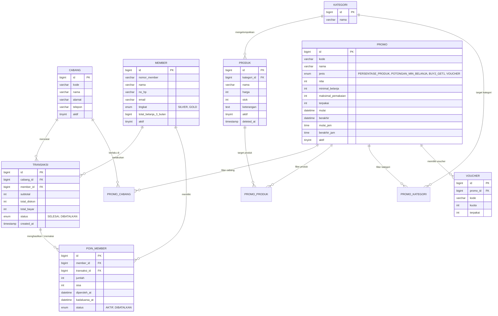

# SeduhPoin — Sistem Poin Member dan Promo Kedai Kopi Seduh

Aplikasi berbasis web untuk **Kedai Kopi Seduh** (3 Cabang) yang mengintegrasikan program loyalitas member, manajemen promo multi-kondisi, transaksi kasir (POS), dan laporan analitik bisnis.

Dibangun menggunakan bahasa **Go (Golang)**, arsitektur modular **Clean/Layered Architecture** (`net/http`, `html/template`), dan database **MySQL / MariaDB (XAMPP)**.

---

## ☕ Ringkasan Studi Kasus (Topik 5)

Kedai Kopi Seduh memiliki tiga cabang: **Pusat**, **Timur**, dan **Barat**. Pemilik ingin menjalankan program keanggotaan (membership) dan promo terpusat yang terhubung dengan transaksi penjualan di semua cabang:

1. **Perolehan Poin Member**:
   - Pelanggan member mendapat **1 poin per kelipatan Rp10.000** dari total belanja setelah potongan promo.
   - Member **Gold** mendapatkan poin **1,5x lipat** dari perolehan standar.
   - Poin memiliki masa berlaku **6 bulan** sejak diperoleh.
2. **Penukaran Poin**:
   - Nilai tukar: **1 poin = Rp1.000**.
   - Maksimal penukaran poin: **50% dari total belanja**.
   - Mekanisme konsumsi poin: **FEFO / FIFO** (poin yang paling dekat masa kadaluarsanya digunakan terlebih dahulu).
3. **Tingkat Keanggotaan (Member Tier)**:
   - **Silver**: Tingkat awal pendaftaran member baru.
   - **Gold**: Member dengan akumulasi total belanja minimal **Rp1.500.000 dalam 3 bulan terakhir**.
4. **Aturan Promo & Voucher**:
   - **Diskon Persentase Produk**: Potongan harga % untuk produk tertentu.
   - **Potongan Minimal Belanja**: Potongan nominal (Rp) jika belanja mencapai batas tertentu.
   - **Beli 2 Gratis 1 (Buy 2 Get 1)**: Untuk kategori produk tertentu.
   - **Voucher Berkode**: Voucher dengan kuota terbatas dan kode khusus.
   - *Batasan*: Promo dapat dibatasi per cabang, jam operasional tertentu (*happy hour*), dan rentang tanggal aktif.
   - *Aturan Kombinasi*: Promo produk **dapat digabung** dengan promo lain, tetapi **potongan minimal belanja TIDAK DAPAT digabung dengan voucher**.
5. **Pembatalan Transaksi**:
   - Poin yang diperoleh dari transaksi dibatalkan ditarik kembali.
   - Poin yang ditukarkan pada transaksi tersebut dikembalikan secara utuh ke saldo member.
6. **Kebutuhan Laporan**:
   - Biaya realisasi setiap promo (total rupiah diskon yang dikeluarkan).
   - Jumlah poin member yang masih aktif dan konversi nilainya dalam rupiah.
   - Tren dan perkembangan jumlah member per tingkat (Silver vs Gold).

---

## 👥 Pembagian Tugas & Lingkup Kerja Tim

| Lingkup | Modul & Tanggung Jawab | Penanggung Jawab | Status |
| :--- | :--- | :--- | :--- |
| **Lingkup 1** | **Master Data**: Pengelolaan data produk, kategori, 3 cabang, dan registrasi member | **Nabila (Ketua)** | Selesai |
| **Lingkup 2** | **Promo & Voucher**: Pengaturan promo, pembatasan cabang/jam, dan kuota voucher | **Nabila (Ketua)** | Selesai |
| **Auth & Session** | **Autentikasi Multi-Peran**: Register, login bcrypt, cookie session HttpOnly, dan proteksi middleware | **Nabila (Ketua)** | Selesai |
| **Lingkup 3** | **Transaksi Penjualan**: Kalkulasi promo, diskon kombinasi, penukaran poin & akumulasi poin | **Rahma** | Siap Dikerjakan |
| **Lingkup 4** | **Pembatalan Transaksi**: Void transaksi, rollback poin diperoleh, refund poin ditukar | **Hilal** | Siap Dikerjakan |
| **Lingkup 5** | **Lifecycle Poin & Tier**: Masa berlaku poin (6 bulan/FIFO) & evaluasi otomatis tier Silver/Gold | **Dinda** | Siap Dikerjakan |
| **Lingkup 6** | **Laporan Analitik**: Biaya promo, saldo poin aktif (Rp), dan statistik pertumbuhan member | **Luhur** | Siap Dikerjakan |

---

## 🏛️ Arsitektur Sistem

Sistem mengadopsi pola **Layered Architecture (Separation of Concerns)** untuk memudahkan kolaborasi multi-anggota tanpa konflik kode (*merge conflict*).

```
[ Browser / Client ]
        │
        ▼ (HTTP Request: GET/POST)
┌─────────────────────────────────────────────────────────────┐
│ 1. HTTP Router & Middleware (cmd/web, internal/middleware)   │
│    - Routing path & HTTP Method (Go 1.22+ ServeMux)         │
│    - Request Logging, Session/Auth Check                     │
└──────────────────────────────┬──────────────────────────────┘
                               │
                               ▼
┌─────────────────────────────────────────────────────────────┐
│ 2. Presentation Layer / Handler (internal/handler)          │
│    - Request binding & Input sanitization                   │
│    - Response View Renderer (HTML Template Execution)       │
└──────────────────────────────┬──────────────────────────────┘
                               │
                               ▼
┌─────────────────────────────────────────────────────────────┐
│ 3. Domain Model (internal/model)                            │
│    - Definisi Struct Produk, Cabang, Member, Promo, Transaksi│
└──────────────────────────────┬──────────────────────────────┘
                               │
                               ▼
┌─────────────────────────────────────────────────────────────┐
│ 4. Data Access Layer / Repository (internal/repository)     │
│    - Query & Exec SQL (MySQL / MariaDB)                     │
│    - Database Transaction (Tx Rollback / Commit)            │
└──────────────────────────────┬──────────────────────────────┘
                               │
                               ▼
┌─────────────────────────────────────────────────────────────┐
│ 5. Database (MySQL via XAMPP)                               │
│    - Database: seduhpoin                                    │
└─────────────────────────────────────────────────────────────┘
```

### Struktur Direktori Proyek

```text
poinseduh/
├── cmd/
│   └── web/
│       └── main.go                 # Entry point server, inisialisasi DB, routing HTTP
├── db/
│   └── schema.sql                  # DDL skema database & data awal (seed)
├── internal/
│   ├── config/
│   │   └── config.go               # Pembaca konfigurasi environment (.env)
│   ├── handler/
│   │   ├── admin.go                # Handler Lingkup 1 & 2 (Cabang, Member, Promo, Voucher)
│   │   ├── catalog.go              # Handler Lingkup 1 (Produk & Kategori)
│   │   ├── halaman.go              # Handler dashboard & profil
│   │   ├── render.go               # Template engine helper & HTML renderer
│   │   └── errors.go               # Error HTTP helper
│   ├── middleware/
│   │   └── logging.go              # HTTP request logger
│   ├── model/
│   │   ├── admin.go                # Entity struct Lingkup 1 & 2
│   │   └── errors.go               # Custom domain errors
│   └── repository/
│       ├── admin.go                # Repository Lingkup 1 & 2 (Cabang, Member, Promo, Voucher)
│       └── catalog.go              # Repository Lingkup 1 (Produk & Kategori CRUD)
├── templates/                      # UI Views (HTML5 + CSS Bertema Kopi)
│   ├── layout.html                 # Base layout, navbar, dan stylesheet
│   ├── header.html                 # Topbar header
│   ├── sidebar.html                # Sidebar navigasi
│   ├── footer.html                 # Footer
│   ├── home.html                   # Dashboard ringkasan
│   ├── produk.html                 # Lingkup 1: UI CRUD Produk & Kategori
│   ├── cabang.html                 # Lingkup 1: UI Manajemen Cabang Kedai
│   ├── member.html                 # Lingkup 1: UI Registrasi & List Member
│   ├── promo.html                  # Lingkup 2: UI Setup Promo & Syarat
│   └── voucher.html                # Lingkup 2: UI Setup Kode & Kuota Voucher
├── .env.example                    # Template konfigurasi lokal
├── .gitignore                      # File ignore Git
├── go.mod                          # Go module definition
├── go.sum                          # Go checksum dependencies
└── README.md                       # Dokumentasi arsitektur dan panduan tim
```

---

## 🗄️ Skema Database (MySQL / XAMPP)

Database telah dinormalisasi untuk mendukung kebutuhan transaksi multi-cabang dan program loyalitas:



---

## 📌 Rincian Modul Selesai (Lingkup 1 & 2 - Nabila)

### 1. Lingkup 1 — Master Data Produk, Cabang, dan Member
- **Menu Produk (`/produk`)**:
  - Penambahan menu kopi, non-kopi, dan makanan dengan kategori relasional.
  - Form edit, input stok, penetapan harga jual, dan soft-delete data produk.
- **Cabang Kedai (`/cabang`)**:
  - Pengelolaan 3 cabang resmi: **Pusat**, **Timur**, dan **Barat**.
  - Kode cabang unik untuk pemisahan operasional dan promosi lokasi.
- **Member Kedai (`/member`)**:
  - Registrasi member baru dengan nomor keanggotaan unik dan kontak (HP/Email).
  - Penetapan tier awal **Silver** dan kolom akumulasi belanja 3 bulan terakhir.

### 2. Lingkup 2 — Pengaturan Promo dan Voucher
- **Promo Engine (`/promo`)**:
  - **4 Jenis Promo**: Diskon Persentase Produk, Potongan Min Belanja, Buy 2 Get 1 Kategori, dan Voucher.
  - **Pembatasan Fleksibel**:
    - Validitas tanggal (`mulai` s/d `berakhir`).
    - Validitas jam tertentu (`mulai_jam` s/d `berakhir_jam`).
    - Pembatasan lokasi cabang tertentu (`promo_cabang`).
    - Penargetan item produk (`promo_produk`) atau kategori (`promo_kategori`).
- **Voucher Khusus (`/voucher`)**:
  - Pengelolaan kode voucher berkode unik dengan limit kuota pemakaian.

### 3. Autentikasi Session & 3 Peran Pengguna (Auth Module - Nabila)
Sistem dilengkapi autentikasi berbasis session cookie (`HttpOnly`, `SameSite=Lax`) dan hashing password `bcrypt` sesuai standar materi kuliah Pemrograman Web:
- **👑 Admin / Pemilik**: Mengelola data produk, cabang, promo, voucher, member, dan memantau ringkasan metrik kedai.
- **☕ Kasir**: Mengoperasikan kasir POS, menerapkan diskon promo, klaim poin, dan pembatalan transaksi.
- **👤 Member / Pelanggan**: Memiliki identitas kartu loyalitas, pantau reward poin, tingkatan Silver/Gold, dan riwayat belanja.

**Akun Demo untuk Uji Coba & Simulasi:**
| Peran | Email | Password |
| :--- | :--- | :--- |
| **👑 Admin / Pemilik (Nabila)** | `nabila@seduhkopi.com` | `admin123` |
| **☕ Kasir** | `kasir@seduhkopi.com` | `kasir123` |
| **👤 Member Loyal** | `member@seduhkopi.com` | `member123` |

---

## 🚀 Panduan Pengerjaan untuk Anggota Tim

### 🔹 Lingkup 3: Transaksi Penjualan (Rahma)
- **Tujuan**: Menyediakan antarmuka kasir/POS untuk membuat pesanan di cabang terpilih.
- **Logika Bisnis yang Harus Diterapkan**:
  1. Hitung subtotal belanja produk.
  2. Terapkan promo:
     - Promo produk (persentase & beli 2 gratis 1) otomatis dievaluasi per item.
     - Evaluasi promo minimal belanja ATAU voucher berkode (**Ingat: Potongan min belanja TIDAK BOLEH digabung dengan voucher**).
     - Validasi jam transaksi berada di dalam `mulai_jam` dan `berakhir_jam` promo.
     - Validasi cabang transaksi cocok dengan target `promo_cabang`.
  3. Penukaran Poin:
     - Cek saldo poin aktif member yang belum kadaluarsa.
     - Maksimal potongan poin: `50% * total_belanja`.
     - 1 poin = Rp1.000.
     - Konsumsi poin menggunakan urutan `kadaluarsa_at ASC` (FIFO/FEFO).
  4. Perolehan Poin:
     - Dihitung dari `total_bayar` akhir setelah semua diskon promo.
     - Dasar: `floor(total_bayar / 10000) * 1 poin`.
     - Jika member bertingkat **Gold**: kalikan poin perolehan dengan **1.5x**.
     - Simpan entri baru di tabel `poin_member` dengan `kadaluarsa_at = NOW() + 6 BULAN`.

### 🔹 Lingkup 4: Pembatalan Transaksi (Hilal)
- **Tujuan**: Membatalkan pesanan yang salah / komplain pelanggan.
- **Logika Bisnis yang Harus Diterapkan**:
  1. Ubah status transaksi menjadi `DIBATALKAN`.
  2. Tarik kembali poin yang diperoleh:
     - Poin yang diterbitkan dari transaksi tersebut di-void (`status = 'DIBATALKAN'`).
  3. Kembalikan poin yang ditukarkan:
     - Poin yang terpotong saat transaksi dikembalikan ke kuota saldo member (`sisa = sisa + poin_terpakai`).
  4. Pulihkan stok produk yang dibatalkan.

### 🔹 Lingkup 5: Pengelolaan Masa Berlaku Poin & Tingkat Member (Dinda)
- **Tujuan**: Background logic / halaman admin monitoring masa aktif poin dan status member.
- **Logika Bisnis yang Harus Diterapkan**:
  1. Filter poin kedaluwarsa: poin dengan `kadaluarsa_at < NOW()` tidak lagi dapat digunakan dalam transaksi.
  2. Evaluasi Tier Member:
     - Hitung akumulasi belanja member dalam 3 bulan terakhir (`SELECT SUM(total_bayar) WHERE created_at >= NOW() - INTERVAL 3 MONTH AND status = 'SELESAI'`).
     - Jika total belanja `>= Rp1.500.000`, naikkan/pertahankan status ke **GOLD**.
     - Jika `< Rp1.500.000`, status adalah **SILVER**.

### 🔹 Lingkup 6: Laporan Promo, Poin, dan Member (Luhur)
- **Tujuan**: Menyediakan dashboard analitik untuk pemilik usaha.
- **Kueri yang Diperlukan**:
  1. **Laporan Biaya Promo**: Rekapitulasi total rupiah diskon yang telah diberikan per kode promo.
  2. **Laporan Poin Beredar**: Total poin aktif yang belum kedaluwarsa beserta nilai konversinya (`total_poin * 1000`).
  3. **Laporan Pertumbuhan Member**: Distribusi jumlah member Silver vs Gold dan pertumbuhan member baru bulanan.

---

## 🛠️ Cara Menjalankan Proyek (Setup Lokal XAMPP)

### Prasyarat
- **Go**: Versi 1.22 atau lebih baru.
- **XAMPP**: Modul Apache & MySQL aktif.
- **Git**

### Langkah Menjalankan
1. **Jalankan MySQL**: Buka XAMPP Control Panel dan nyalakan service MySQL.
2. **Import Database**:
   - Buka phpMyAdmin (`http://localhost/phpmyadmin`).
   - Import file [`db/schema.sql`](db/schema.sql). Database `seduhpoin` beserta data awal akan otomatis dibuat.
3. **Konfigurasi Environment**:
   - Buat salinan `.env` dari `.env.example` jika belum ada:
     ```bash
     cp .env.example .env
     ```
   - Pastikan konfigurasi DSN database sesuai:
     ```env
     DB_DSN=root:@tcp(127.0.0.1:3306)/seduhpoin?parseTime=true&charset=utf8mb4
     ADDR=:8080
     ```
4. **Jalankan Aplikasi**:
   ```bash
   go run ./cmd/web
   ```
5. **Buka Aplikasi**:
   Akses `http://localhost:8080` pada web browser Anda.

---

## 🌿 Panduan Kolaborasi Git Tim

Untuk menjaga kode tetap rapi dan tidak saling menimpa, gunakan alur kerja Git berikut:

1. **Clone & Buat Branch Baru**:
   ```bash
   git checkout -b fitur/lingkup-3-transaksi    # Contoh untuk Rahma
   git checkout -b fitur/lingkup-4-pembatalan   # Contoh untuk Hilal
   git checkout -b fitur/lingkup-5-poin-tier    # Contoh untuk Dinda
   git checkout -b fitur/lingkup-6-laporan      # Contoh untuk Luhur
   ```
2. **Commit dengan Pesan Jelas**:
   ```bash
   git add .
   git commit -m "feat(transaksi): tambah kalkulasi diskon promo dan poin"
   ```
3. **Tarik Update Terbaru Sebelum Push**:
   ```bash
   git pull origin main
   git push origin fitur/lingkup-3-transaksi
   ```
4. **Merge ke `main`**: Lakukan Pull Request / koordinasi dengan Nabila selaku ketua sebelum digabungkan ke branch utama.
