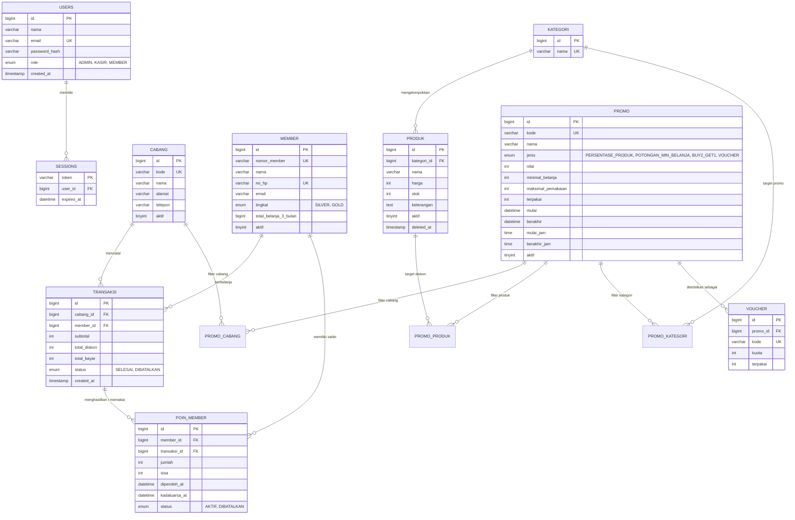

# SeduhPoin — Sistem Poin Member dan Promo Kedai Kopi Seduh

Sistem informasi manajemen berbasis web untuk **Kedai Kopi Seduh** (3 Cabang: Pusat, Timur, dan Barat) yang mengintegrasikan pengelolaan master data, konfigurasi promosi multi-kondisi, transaksi kasir POS, loyalitas member berjenjang (Silver & Gold), serta laporan analitik biaya promosi dan poin aktif.

Aplikasi dibangun menggunakan bahasa **Go (Golang)** murni dengan arsitektur modular **Clean/Layered Architecture** (`net/http`, `html/template`), database **MySQL (XAMPP)**, serta antarmuka HTML5 & CSS modern bertema kedai kopi.

---

## ☕ Spesifikasi & Aturan Bisnis (Topik 5)

Kedai Kopi Seduh memiliki tiga cabang operasional. Sistem menghubungkan program keanggotaan dan promosi dengan transaksi penjualan di seluruh cabang:

1. **Perolehan Poin Member**:
   - Pelanggan yang terdaftar sebagai member mendapatkan **1 poin untuk setiap kelipatan Rp10.000** dari total belanja setelah potongan promo (pembulatan ke bawah).
   - Member dengan tingkat **Gold** mendapatkan poin **1,5 kali lipat** dari perolehan standar.
   - Poin memiliki masa berlaku **6 bulan** sejak tanggal diperoleh.
2. **Penukaran Poin (Redemption)**:
   - Nilai tukar: **1 poin = Rp1.000**.
   - Maksimal penukaran poin: **Paling banyak 50% dari total belanja** (setelah diskon promo).
   - Urutan konsumsi poin: **FEFO / FIFO** (poin yang paling dekat masa berlakunya/kedaluwarsa dikonsumsi terlebih dahulu).
3. **Tingkat Member (Membership Tiers)**:
   - Terdiri dari dua tingkat: **Silver** dan **Gold**.
   - Member baru memulai dari tingkat **Silver**.
   - Member dengan akumulasi belanja minimal **Rp1.500.000 dalam 3 bulan terakhir** berhak menjadi **Gold** dan menikmati multiplier poin 1,5x.
4. **Jenis & Ketentuan Promo**:
   - **Diskon Persentase Produk (`PERSENTASE_PRODUK`)**: Potongan harga persentase untuk item produk tertentu.
   - **Potongan Minimal Belanja (`POTONGAN_MIN_BELANJA`)**: Potongan nominal rupiah jika transaksi mencapai batas belanja tertentu.
   - **Beli 2 Gratis 1 (`BUY2_GET1`)**: Promo beli 2 gratis 1 untuk kategori produk tertentu.
   - **Voucher Berkode (`VOUCHER`)**: Kupon berkode unik dengan kuota pemakaian terbatas.
   - *Batasan Fleksibel*: Promo dapat dibatasi berdasarkan rentang tanggal aktif, cabang tertentu (`promo_cabang`), dan jam operasional (*happy hour*: `mulai_jam` - `berakhir_jam`).
   - *Aturan Penggabungan Promo*: Promo produk dapat digabung dengan promo lain, tetapi **potongan minimal belanja TIDAK DAPAT digabung dengan voucher**.
5. **Pembatalan Transaksi**:
   - Jika transaksi dibatalkan:
     - Poin yang diperoleh dari transaksi tersebut ditarik kembali (*void*).
     - Poin yang ditukarkan pada transaksi tersebut dikembalikan secara utuh kepada member.
     - Stok produk dipulihkan dan kuota voucher dikembalikan.
6. **Kebutuhan Laporan**:
   - Laporan biaya setiap promo (total nominal rupiah diskon yang dikeluarkan per promo).
   - Jumlah poin yang masih berlaku beserta nilainya dalam rupiah (`sisa_poin * 1.000`).
   - Perkembangan dan distribusi jumlah member per tingkat (Silver vs Gold).

---

## 👥 Pembagian Lingkup Kerja Tim

| Lingkup | Modul & Tanggung Jawab | Penanggung Jawab | Status |
| :--- | :--- | :--- | :--- |
| **Lingkup 1** | **Master Data**: Pengelolaan produk, kategori, 3 cabang, dan data member | **Nabila** | Selesai |
| **Lingkup 2** | **Pengaturan Promo & Voucher**: Promo multi-kondisi, batasan jam/cabang, dan kuota voucher | **Nabila** | Selesai |
| **Auth** | **Autentikasi & Session**: Register, login bcrypt, cookie session HttpOnly, dan middleware | **Nabila** | Selesai |
| **Lingkup 3** | **Transaksi Penjualan**: Perhitungan promo kombinasi, penukaran poin FEFO, dan akumulasi poin | **Rahma** | Siap Dikerjakan |
| **Lingkup 4** | **Pembatalan Transaksi**: Rollback status, penarikan poin reward, refund poin terpakai, restock | **Hilal** | Siap Dikerjakan |
| **Lingkup 5** | **Lifecycle Poin & Tier Member**: Validasi expired 6 bulan & evaluasi belanja 3 bulan (Silver/Gold) | **Dinda** | Siap Dikerjakan |
| **Lingkup 6** | **Laporan Analitik**: Biaya realisasi promo, saldo poin aktif (Rp), dan statistik member | **Luhur** | Siap Dikerjakan |

---

## 🏛️ Arsitektur Sistem

Sistem menggunakan **Layered Architecture** untuk menjamin keteraturan kode dan memudahkan pengerjaan paralel antar anggota tim tanpa konflik:

```text
poinseduh/
├── cmd/
│   └── web/
│       └── main.go                 # HTTP ServeMux, Server lifecycle, dependency injection
├── db/
│   ├── schema.sql                  # DDL skema lengkap MySQL & seed data awal
│   └── auth.sql                    # Skema tabel users, sessions, dan akun demo
├── internal/
│   ├── config/
│   │   └── config.go               # Pembaca konfigurasi environment (.env)
│   ├── handler/
│   │   ├── auth.go                 # Login, register, logout
│   │   ├── admin.go                # Handler cabang, member, promo, voucher (Lingkup 1 & 2)
│   │   ├── catalog.go              # Handler CRUD produk & kategori (Lingkup 1)
│   │   ├── halaman.go              # Handler dashboard ringkasan
│   │   ├── render.go               # Engine HTML Template renderer
│   │   └── errors.go               # HTTP error helper
│   ├── middleware/
│   │   ├── auth.go                 # Middleware RequireLogin & konteks User
│   │   └── logging.go              # Request HTTP logger
│   ├── model/
│   │   ├── admin.go                # Entity: Cabang, Produk, Member, Promo, Voucher
│   │   ├── user.go                 # Entity User & domain error auth
│   │   └── errors.go               # Sentinel errors
│   ├── repository/
│   │   ├── admin.go                # Query SQL Cabang, Member, Promo, Voucher
│   │   ├── catalog.go              # Query SQL Produk & Kategori
│   │   ├── user.go                 # Query SQL Users
│   │   └── session.go              # Query SQL Sessions
│   └── service/
│       └── auth.go                 # Logika bisnis autentikasi bcrypt & session
├── templates/                      # UI Views (HTML5 + CSS Bertema Kopi)
│   ├── auth/
│   │   ├── login.html              # Halaman login modern
│   │   └── register.html           # Halaman registrasi akun
│   ├── layout.html                 # Master layout & responsive stylesheet
│   ├── header.html                 # Topbar header
│   ├── sidebar.html                # Sidebar navigasi profesional
│   ├── footer.html                 # Footer aplikasi
│   ├── home.html                   # Dashboard ringkasan eksekutif
│   ├── produk.html                 # Lingkup 1: UI CRUD Produk & Kategori
│   ├── cabang.html                 # Lingkup 1: UI Cabang Kedai
│   ├── member.html                 # Lingkup 1: UI Registrasi & List Member
│   ├── promo.html                  # Lingkup 2: UI Pengaturan Promo
│   └── voucher.html                # Lingkup 2: UI Voucher Berkode
├── .env                            # Konfigurasi aktif lokal
├── .env.example                    # Template konfigurasi
├── .gitignore                      # File pengecualian Git
├── go.mod                          # Definisi Go module
└── README.md                       # Dokumentasi sistem & panduan teknis tim
```

---

## 🗄️ Skema Database (MySQL / XAMPP)

Tabel-tabel database `seduhpoin` telah dirancang dan dinormalisasi untuk memenuhi seluruh kebutuhan sistem:



---

## 📌 Status Implementasi Modul Selesai (Nabila)

### 1. Lingkup 1 — Pengelolaan Data Produk, Cabang, dan Member
- **Menu & Stok Produk (`/produk`)**: CRUD produk lengkap terhubung relasi kategori, penetapan harga jual, manajemen kuantitas stok, dan mekanisme soft-delete (`deleted_at`).
- **Cabang Kedai (`/cabang`)**: Manajemen data 3 cabang resmi (**Seduh Pusat**, **Seduh Timur**, dan **Seduh Barat**) lengkap dengan kode identifikasi, nomor kontak, dan alamat operasional.
- **Data Member (`/member`)**: Pendaftaran kartu anggota loyalitas, format kontak unik, penanda tingkatan **Silver** (standar) dan **Gold** (belanja $\ge$ Rp1.500.000 dalam 3 bulan terakhir).

### 2. Lingkup 2 — Pengaturan Promo dan Voucher
- **Pengaturan Promo Multi-Kondisi (`/promo`)**:
  - 4 jenis promo: Diskon Persentase Produk, Potongan Min. Belanja, Buy 2 Get 1 Kategori, dan Promo Berbasis Voucher.
  - Batasan fleksibel: Rentang tanggal berlaku, jam operasional tertentu (*happy hour*), dan seleksi target cabang maupun item produk/kategori.
- **Kupon Voucher Berkode (`/voucher`)**:
  - Penerbitan kode voucher eksklusif dengan pembatasan kuota klaim maksimal.

### 3. Autentikasi & Session Multi-Peran (Auth Module)
- Login berbasis cookie session `HttpOnly` dengan keamanan `SameSite=Lax`.
- Hashing password menggunakan algoritma `bcrypt`.
- Mendukung 3 peran pengguna:
  - **👑 Admin / Pemilik**: Hak akses penuh kelola master data, promo, voucher, member, dan memantau analitik.
  - **☕ Kasir**: Menangani kasir POS transaksi, klaim promo, penukaran poin, dan pembatalan transaksi.
  - **👤 Member**: Memiliki nomor anggota, cek reward poin, tiering, dan riwayat belanja.

**Kredensial Akun untuk Simulasi:**
- **Admin/Pemilik**: `nabila@seduhkopi.com` | Password: `admin123`
- **Kasir**: `kasir@seduhkopi.com` | Password: `kasir123`
- **Member**: `member@seduhkopi.com` | Password: `member123`

---

## 🚀 Panduan Teknis untuk Anggota Tim (Lingkup 3, 4, 5, 6)

Berikut panduan langkah pengerjaan yang terstruktur untuk rekan-rekan tim:

---

### 🔹 Lingkup 3: Transaksi Penjualan (Rahma)
- **Tujuan**: Membangun modul kasir penjualan (POS) di cabang terpilih yang menghitung kalkulasi promo, penukaran poin, dan perolehan poin baru.
- **Berkas yang Perlu Dibuat / Dimodifikasi**:
  - `internal/handler/transaksi.go` (routing `GET /transaksi` & `POST /transaksi`)
  - `internal/repository/transaksi.go`
  - `templates/transaksi.html`
  - Daftarkan route di `cmd/web/main.go` dan tambahkan link di `templates/sidebar.html`.
- **Langkah Logika Bisnis**:
  1. **Hitung Subtotal**: Total dari $\sum (\text{harga} \times \text{qty})$.
  2. **Evaluasi Diskon Promo**:
     - *Diskon Persentase Produk*: Cek produk yang ada di `promo_produk`. Potong harga sebesar $X\%$.
     - *Buy 2 Get 1*: Untuk setiap 3 item dalam kategori target `promo_kategori`, berikan 1 item gratis.
     - *Potongan Min. Belanja vs Voucher*: **Aturan mutlak:** Jika pelanggan memasukkan voucher, promo potongan min. belanja tidak boleh diaplikasikan. Validasi juga cabang transaksi dan rentang jam transaksi (*happy hour*).
  3. **Penukaran Poin Member**:
     - Cek apakah transaksi memilih member terdaftar.
     - Ambil saldo poin aktif member yang belum kedaluwarsa (`sisa > 0 AND status = 'AKTIF' AND kadaluarsa_at > NOW()`).
     - **Batas maksimal penukaran poin:** Paling banyak **50% dari total belanja** setelah potongan promo.
     - **Nilai tukar:** 1 poin = Rp1.000.
     - **Urutan konsumsi poin (FEFO/FIFO):** Ambil baris poin dengan urutan `kadaluarsa_at ASC`. Kurangi kolom `sisa` pada tabel `poin_member`.
  4. **Perolehan Poin Baru**:
     - Poin baru dihitung dari `total_bayar` akhir.
     - Aturan: `floor(total_bayar / 10000) * 1 poin`.
     - **Multiplier Tier Gold:** Jika member berstatus `GOLD`, kalikan perolehan poin dengan **1,5x** (contoh: belanja Rp100.000 $\rightarrow$ Silver dapat 10 poin, Gold dapat 15 poin).
     - Masukkan baris baru ke tabel `poin_member` dengan masa kedaluwarsa 6 bulan:
       `INSERT INTO poin_member (member_id, transaksi_id, jumlah, sisa, diperoleh_at, kadaluarsa_at, status) VALUES (?, ?, ?, ?, NOW(), NOW() + INTERVAL 6 MONTH, 'AKTIF')`.
  5. **Kurangi Stok**: Potong stok produk di tabel `produk`.

---

### 🔹 Lingkup 4: Pembatalan Transaksi (Hilal)
- **Tujuan**: Membatalkan transaksi penjualan jika terjadi kesalahan atau pembatalan pesanan oleh pelanggan.
- **Berkas yang Perlu Dibuat / Dimodifikasi**:
  - `internal/handler/batal.go` (routing `POST /transaksi/{id}/batal`)
  - `internal/repository/batal.go`
  - Tampilkan tombol "Batalkan Transaksi" pada riwayat transaksi.
- **Langkah Logika Bisnis (Harus dalam 1 Database Transaction / `db.BeginTx`)**:
  1. Validasi transaksi yang akan dibatalkan (pastikan status saat ini adalah `SELESAI`).
  2. Ubah status transaksi menjadi `DIBATALKAN`:
     `UPDATE transaksi SET status = 'DIBATALKAN' WHERE id = ?`.
  3. **Tarik Kembali Poin Diperoleh**:
     - Poin yang diterbitkan dari transaksi tersebut di-void agar tidak bisa dipakai di kemudian hari:
       `UPDATE poin_member SET status = 'DIBATALKAN', sisa = 0 WHERE transaksi_id = ? AND status = 'AKTIF'`.
  4. **Kembalikan Poin yang Ditukarkan**:
     - Jika transaksi tersebut menggunakan penukaran poin, pulihkan kembali poin tersebut ke saldo member.
  5. **Restock Produk & Kuota Voucher**:
     - Tambahkan kembali kuantitas stok produk yang dibatalkan.
     - Jika transaksi menggunakan voucher, kurangi pemakaian voucher (`UPDATE voucher SET terpakai = terpakai - 1`).

---

### 🔹 Lingkup 5: Pengelolaan Masa Berlaku Poin & Tingkat Member (Dinda)
- **Tujuan**: Menangani validasi kedaluwarsa poin (6 bulan) dan evaluasi otomatis tingkat keanggotaan (Silver vs Gold).
- **Berkas yang Perlu Dibuat / Dimodifikasi**:
  - `internal/handler/member_tier.go` (routing `GET /member/tier`)
  - `internal/repository/member_tier.go`
  - `templates/poin_tier.html` (halaman monitoring saldo poin per batch & status tier member).
- **Langkah Logika Bisnis**:
  1. **Masa Berlaku Poin (6 Bulan)**:
     - Tampilkan riwayat batch poin per member: tanggal perolehan, tanggal kedaluwarsa, jumlah awal, sisa poin, dan status (Aktif/Kedaluwarsa/Dibatalkan).
     - Query poin aktif valid:
       ```sql
       SELECT member_id, SUM(sisa) AS poin_aktif, (SUM(sisa) * 1000) AS nilai_rupiah
       FROM poin_member
       WHERE status = 'AKTIF' AND kadaluarsa_at > NOW()
       GROUP BY member_id;
       ```
  2. **Evaluasi Tingkat Keanggotaan (Silver & Gold)**:
     - Hitung akumulasi belanja riil member dalam 3 bulan terakhir:
       ```sql
       SELECT COALESCE(SUM(total_bayar), 0)
       FROM transaksi
       WHERE member_id = ? AND status = 'SELESAI'
         AND created_at >= NOW() - INTERVAL 3 MONTH;
       ```
     - **Aturan Evaluasi:**
       - Jika total belanja 3 bulan $\ge$ **Rp1.500.000** $\rightarrow$ Status diubah/dipertahankan menjadi **GOLD**.
       - Jika total belanja 3 bulan $<$ **Rp1.500.000** $\rightarrow$ Status menjadi **SILVER**.
     - Simpan hasil perhitungan ke `UPDATE member SET tingkat = ?, total_belanja_3_bulan = ? WHERE id = ?`.

---

### 🔹 Lingkup 6: Laporan Promo, Poin, dan Member (Luhur)
- **Tujuan**: Membangun modul pelaporan analitik bisnis untuk pemilik kedai.
- **Berkas yang Perlu Dibuat / Dimodifikasi**:
  - `internal/handler/laporan.go` (routing `GET /laporan`)
  - `internal/repository/laporan.go`
  - `templates/laporan.html`
- **3 Laporan Wajib Sesuai Soal Topik 5**:
  1. **Laporan Biaya Setiap Promo**:
     - Menghitung total realisasi rupiah potongan diskon yang diserap oleh masing-masing promo.
     - Rekap berdasarkan kode promo, jenis promo, jumlah pemakaian, dan total nominal rupiah diskon yang dikeluarkan kedai.
  2. **Laporan Poin yang Masih Berlaku & Nilai Rupiahnya**:
     - Menampilkan total poin aktif yang masih berlaku di seluruh cabang:
       ```sql
       SELECT 
           COUNT(DISTINCT member_id) AS total_member_berpoin,
           COALESCE(SUM(sisa), 0) AS total_poin_aktif,
           COALESCE(SUM(sisa) * 1000, 0) AS total_nilai_rupiah
       FROM poin_member
       WHERE status = 'AKTIF' AND kadaluarsa_at > NOW();
       ```
  3. **Laporan Perkembangan Jumlah Member per Tingkat**:
     - Rekapitulasi perbandingan total member **Silver** vs **Gold**.
     - Grafik atau tabel distribusi keanggotaan dan pertumbuhan member baru per bulan.

---

## 🛠️ Panduan Menjalankan Aplikasi di Lokal (XAMPP)

1. **Jalankan Apache & MySQL di XAMPP Control Panel**.
2. **Import Database (Cukup 1 Berkas)**:
   - Buka phpMyAdmin di `http://localhost/phpmyadmin`.
   - Import berkas [`db/schema.sql`](db/schema.sql). Database `seduhpoin`, seluruh tabel, dan data simulasi awal akan otomatis terbuat.
3. **Konfigurasi `.env`**:
   Pastikan berkas `.env` ada di root direktori dengan isi:
   ```env
   DB_DSN=root:@tcp(127.0.0.1:3306)/seduhpoin?parseTime=true&charset=utf8mb4
   ADDR=:8080
   COOKIE_SECURE=false
   ```
4. **Jalankan Web Server**:
   ```bash
   go run ./cmd/web
   ```
5. **Akses Aplikasi**:
   Buka peramban di `http://localhost:8080`.
   Gunakan akun demo:
   - Email: `nabila@seduhkopi.com`
   - Password: `admin123`

---

## 🌿 Panduan Kolaborasi Git Tim

1. **Buat Branch Kerja Khusus**:
   ```bash
   git checkout -b fitur/lingkup-3-transaksi    # Rahma
   git checkout -b fitur/lingkup-4-batal        # Hilal
   git checkout -b fitur/lingkup-5-poin-tier    # Dinda
   git checkout -b fitur/lingkup-6-laporan      # Luhur
   ```
2. **Commit dengan Pesan Deskriptif**:
   ```bash
   git add .
   git commit -m "feat(lingkup-3): kalkulasi diskon promo dan penukaran poin FEFO"
   ```
3. **Sinkronisasi dengan `main` Sebelum Push**:
   ```bash
   git pull origin main
   git push origin <nama-branch-kamu>
   ```
